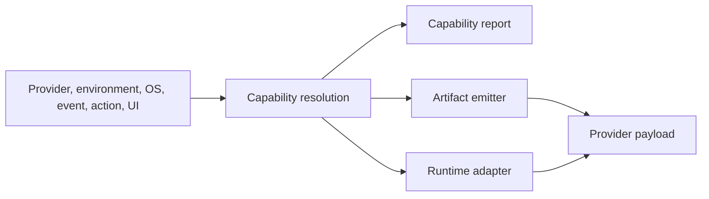
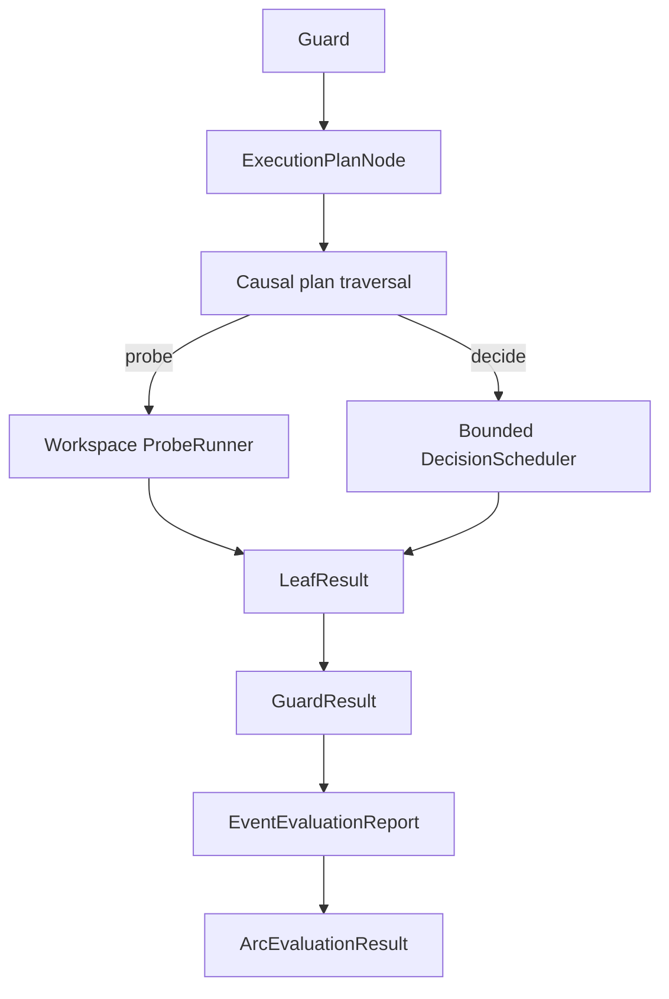
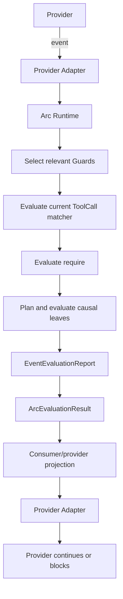
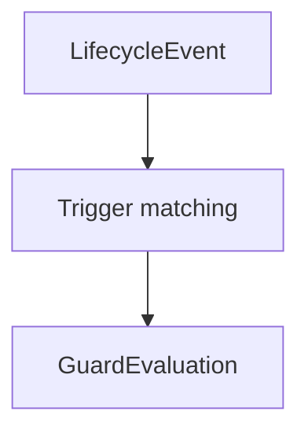
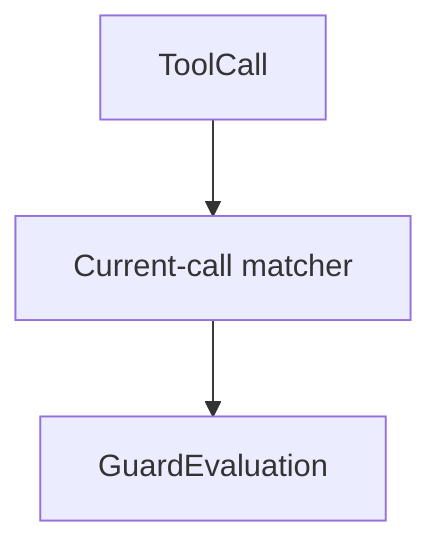
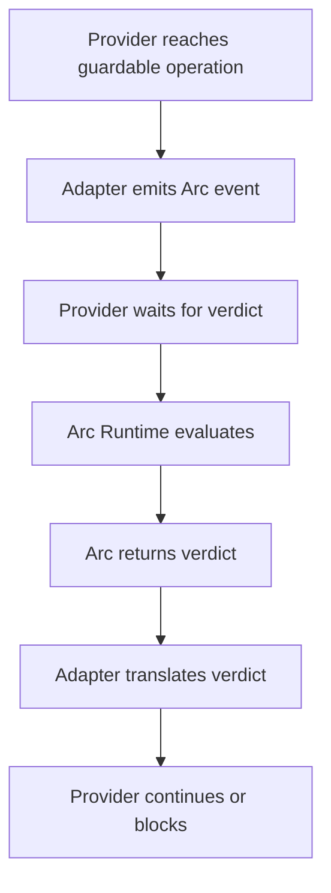
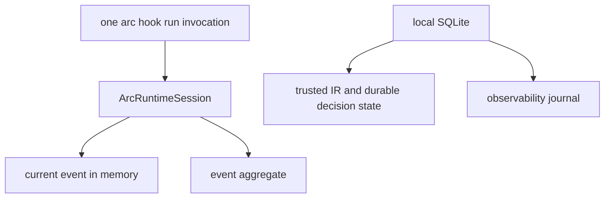

# Arc architecture

This document explains how Arc works inside: the compiler and runtime model, how a `decide` is evaluated, the validation rules and the invariants of schema `1.0`. It is for contributors and for readers who want the reasoning behind the behavior.

[USAGE](USAGE.md) is the guide and reference. Where this document and USAGE or the observed behavior of the `arc` executable differ, USAGE and the observed behavior win. Most of the text below was moved from earlier versions of USAGE without changes and has not been checked again against `src/`.

## Overview

1. **Arc Compiler** reads and validates an Arc workspace, resolves reusable definitions, verifies target compatibility, and generates provider-specific artifacts and adapters.
2. **Arc Runtime** runs alongside the selected provider session, receives normalized provider events, evaluates Arc guards, and returns verdicts when the provider exposes a compatible control boundary.

Arc does not replace or own the provider's agent loop. The provider remains responsible for running the agent, invoking models, invoking tools, maintaining provider-owned state, and applying provider-specific continue/block behavior.

The Arc schema describes **what behavior is required**. A target compiler and provider adapter decide **how that behavior is represented** for a provider.

Provider-specific mechanisms such as hooks, callbacks, wrappers, event streams, runtime APIs, process control, tool interception, session blocking, model-call plumbing, or IPC are implementation details of each target unless the Arc schema explicitly defines otherwise. `model_call` and `model_response` are not public Arc events; the portable lifecycle contract is `start`, `end`, and `tool_call`.

If a valid Arc configuration cannot be represented without changing its semantics for a selected provider, the build must fail for target incompatibility. A declared `Partial` or `Emulated` capability is not silent weakening: it is reported with its guarantee and coverage surface, while `Unsupported` is rejected before emission.

### Capability resolution

The level is resolved from one complete context: provider, real environment,
target OS, event, requested action, selected decision-UI mode, and transports
actually available. The same resolution supplies the effective action,
guarantee, mechanism and coverage surface to the report, emitter and runtime
adapter. The portable CLI surfaces currently emitted by Arc are:

The same resolved contract must flow through every integration layer:



## Decision evaluation

### Evidence and session context

Arc also supplies guard-scoped evidence for deterministic work already
performed during the current event. This includes the operation matchers that
were actually evaluated and each reached probe's command, expected values,
boolean result, and observed-output SHA-256. Raw probe stdout is not included
by default. Short-circuited matchers and rule nodes are omitted because Arc did
not evaluate them. The semantic auditor is instructed to accept these bounded
results as Arc-attested facts and resolve only the remaining semantic question;
it cannot override Arc's deterministic result. If an evidence limit is reached,
the payload marks the corresponding list as truncated and still retains the
matcher that selected the guard.

Session context resolution is isolated by provider. A Codex event cannot fall
back to an Antigravity transcript, and an Antigravity event cannot consume a
Codex rollout. For Antigravity, a valid provider-delivered `transcriptPath` is
authoritative. If the hook omits it, Arc resolves the conversation directory
and treats `transcript_full.jsonl` and `transcript.jsonl` as complete and compact
views of the same stream, preferring the complete view. Two distinct matching
conversation roots remain ambiguous and fail closed.

### Evaluation and authorization boundary

The current runtime does not expose a public suspension/continuation engine for
`decide`. It plans each Guard into `ExecutionPlanNode`, traverses the plan
lazily to run reached probes, then sends reached `decide` leaves through the
bounded `DecisionScheduler`. Their results reduce into the same Guard result,
event report, and aggregate:



`PendingDecision` is private, activation-local plan state. It is not a
durable public continuation and it does not authorize a future operation.
`decide: true` is semantic evidence only. For a `ToolCall`, the aggregate must
still carry an exact authorization requirement for the current operation. Arc
then opens an interactive `Ask` for that exact call and keeps the hook pending
until the user chooses `Allow` or `Deny`. The semantic disposition remains
`Continue`; the user choice is a separate authorization step. `Allow` applies
only to the pending call. `Deny`, an unavailable transport, a closed dialog, or
an unresolved response blocks the call without creating an authorization.

### Internal decision calls

Model activity used internally to resolve an Arc `decide` must not recursively appear as a normal agent event that reactivates public Guards.

The provider adapter must preserve this distinction using whatever mechanism is actually available.

### Decision UI sidecar

The Arc-owned window is a Tauri sidecar with a Svelte/Vite frontend. It is not
HTML assembled inside Rust. The runtime sends a bounded `DialogRequest` over
the child process stdin and validates one bounded `DialogResponse` from stdout.
The window remains hidden until the frontend has mounted and reported the same
request ID; a missing ready signal fails closed. Layout and styles live under
`ui/decision`, and `npm run dev` provides a non-authorizing browser preview with
HMR. See `docs/DECISION_UI_ARCHITECTURE.md` for the complete boundary.

## Runtime model

### Runtime responsibility

For the current CLI integrations, provider-generated hooks invoke `arc hook
run` once per supported event. Each invocation reads one provider payload,
loads a `BehaviorIR` registered as trusted by `arc build`, normalizes the
event, evaluates its matching Guards, and returns the provider-specific hook
response. Arc does not run the provider's agent loop or an independent polling
daemon.

`ArcRuntimeSession` is created inside that hook invocation. Its event buffer
and activation cache are in-memory state for the invocation. State that must
survive later hooks, including trusted IR registration, workspace identity,
interactive decision coordination, and the metadata-only observability
journal, is stored separately in Arc's local SQLite database.

Conceptually:



Arc Runtime does not execute the provider's agent loop.

### Runtime events

The conceptual runtime event vocabulary includes:

| Event | Domain | Logical meaning |
| --- | --- | --- |
| `start` | Lifecycle | Initial Arc-visible session boundary (turn 1) |
| `end` | Lifecycle | Final Arc-visible session boundary |
| `tool_call` | Tool | Before one concrete provider tool invocation |

These are logical Arc events, not provider API names.

A provider target may map one or several concrete provider primitives to an Arc event only when the resulting Arc semantics are preserved.

### Event envelope

Conceptually, Arc Runtime receives events with enough information for deterministic processing:

```text
ArcEvent {
    session_id
    event_id
    type
    sequence
    correlation_id?
    payload
}
```

`payload` contains only normalized evidence that the provider adapter can truthfully expose.

The adapter must not invent missing evidence.

---

### Guard activation is event-local

The provider integration determines when an event reaches Arc. In the current
CLI path, generated hooks invoke `arc hook run` once per supported event; Arc
does not independently observe future provider activity. Guards are evaluated
only for the event delivered to that invocation.

#### Lifecycle Guard



#### Tool Guard



There is no generic `observe` condition in schema `1.0`.

---

### `GuardEvaluation`

One concrete Guard activation creates one logical Guard evaluation.

Conceptually:

```text
GuardEvaluation {
    evaluation_id
    session_id
    guard_id
    originating_event_id
    requirement
    state
}
```

`GuardEvaluation` is not an event and does not represent a time window.

It represents the evaluation caused by one current runtime activation.

---

### Multiple Guards for one event

A single runtime event may activate multiple Guards.

Arc:

1. finds relevant Guards;
2. sorts them by `order`;
3. preserves YAML order for ties;
4. creates one immutable evaluation snapshot and evaluates every applicable
   Guard in a batch;
5. reduces all Guard results before applying precedence
   `RuntimeFault > Deny > Ask > Message > Continue`.

A `RuntimeFault` outranks `Deny`; otherwise `Deny` outranks `Ask`, `Message`,
and `Continue`.

The batch planner runs reached probes during lazy traversal and sends reached
`decide` leaves through the bounded scheduler. Logical Guard occurrences
retain their own causal path; equivalent leaf work is coalesced only within the
current hook activation. `ArcRuntimeSession::evaluate_event_aggregate` is the
production boundary and returns `ArcEvaluationResult`. There is no second
enforcement engine and no public continuation contract.

#### Canonical aggregate result

Every completed event evaluation is represented by one validated aggregate:

```rust
ArcEvaluationResult {
    report: EventEvaluationReport,
    effective_disposition: EffectiveDisposition,
    authorization_requirements: Vec<ExactOperationAuthorization>,
    failure_bundle: FailureBundle,
}
```

The constructor validates report/bundle identity, invocation and input
fingerprints, complete Guard coverage, deterministic Guard ordering, bounded
evidence, and exact authorization identity. It rejects an authorization whose
`guard_id` is absent from the report, rejects non-canonical report or
authorization order, and validates standalone bundle identity. When configured feedback is retained, the runtime derives it from the matched
`BehaviorIR` validated against an authoritative external trust anchor (`TrustedIrAnchor` /
`TrustedIrSnapshot`) issued by SQLite (`trusted_irs`). Unanchored sessions produce `configured_feedback: None`
to prevent projecting unverified feedback. The former spec-based, self-asserted, and arbitrary string-digest
constructors are retired; `from_report_with_trusted_anchor` requires an authentic store-issued anchor and
checks Guard ID, order, declaration order, action, and external raw byte digest integrity against the report.
Consumers project this aggregate into provider output or an interactive
request; they do not re-evaluate Rules or manufacture a singular primary
failure.

---

### Provider control boundary

Arc cannot independently take control back after a provider operation has already escaped the provider's control boundary.

The correct enforcement model is cooperative:



If the provider cannot preserve the required control point, the selected target is incompatible with that configuration.

---

### Verdicts

For schema `1.0`, `EffectiveDisposition` is reduced once for the complete
aggregate with precedence:

```text
RuntimeFault > Deny > Ask > Message > Continue
```

The consumer projection is:

| Disposition | Current-operation meaning | Interactive UI |
| --- | --- | --- |
| `RuntimeFault` | Fail closed; do not continue | No |
| `Deny` | Apply the provider's terminal response to the current guarded event | No |
| `Ask` | Resolve the aggregate failed-Guard request | Yes, when a valid transport exists |
| `Message` | Return feedback without blocking | No by itself |
| `Continue` | No failed-Guard disposition; an exact ToolCall authorization still requires a user choice | Yes, when an exact authorization exists and a valid transport is available |

An exact authorization is separate from `EffectiveDisposition`. For example,
`decide: true` can leave a ToolCall's disposition at `Continue` while the hook
opens Ask and waits for the user. `Continue` alone does not mean the provider
may execute a call with unresolved exact authorization. `Deny` and
`RuntimeFault` remain terminal and suppress the dialog even when exact
authorization requirements are also present.

The provider adapter translates these outcomes to the provider protocol. For
example, a Codex tool `Deny` becomes
`hookSpecificOutput.permissionDecision: "deny"`. A Gemini tool `Ask` uses the
provider's native `force_ask` only when `--decision-ui provider` is selected;
with the default `auto` mode, Arc opens its embedded UI and classifies that
transport as `Emulated`. The exact JSON fields are provider-specific and are
not part of the Arc schema.

These outcomes correspond to Guard semantics:

```text
require == true
-> Continue contribution

require == false + on_failure.action == deny
-> Deny current guarded operation

require == false + on_failure.action == ask
-> Ask through the resolved decision transport

require == false + on_failure.action == message
-> Message without blocking
```

The concrete provider API used to implement these outcomes is target-specific.
For `tool_call`, `Deny` blocks the current call. For `end`/`Stop`, an
unresolved `Ask` keeps the provider loop active for reevaluation; a user's
explicit `Deny` of remediation honors that stop attempt. A configured Guard
`Deny` or `RuntimeFault` follows the target's own Stop output contract.
`Start`/`PreInvocation` `Ask` remains invalid. Provider-live and UI-live
evidence remains separate from this core contract.

---

### Event Buffer and session state

In the CLI hook path, `ArcRuntimeSession` owns an in-memory Event Buffer while
one `arc hook run` invocation is active. The generated hooks normally deliver
one provider event per invocation, so this buffer is not persisted or replayed
across hook processes.

Conceptually:



Within that invocation, the buffer supports:

- deterministic ordering for the current event;
- event and Guard evaluation correlation;
- diagnostics and bounded activation summaries;
- Arc-owned runtime state for the current invocation.

Trusted IR registrations, workspace IDs, durable decision claims and receipts,
and observability events are stored in SQLite separately. The activation cache
is also invocation-local and is dropped after the hook result is prepared.

Current Tool Guard `matches` semantics do not search or wait over the buffer. They evaluate the current ToolCall.

State itself is not a verdict.

An undesirable state only matters when an activated Guard requires a Rule that evaluates that state.

---

### Concurrency

Different provider hook invocations may execute concurrently. Within one
event batch, Guards and their report are ordered by `order`, declaration
order, and Guard ID. Arc does not serialize every event in a provider session
or promise a total order for concurrent hook processes; provider delivery and
available session, event, turn, and invocation identifiers determine their
correlation. SQLite coordinates durable decision state across invocations,
separately from the in-memory event buffer and activation cache.

### Build migration

When migrating output generated by an older Arc version, a legacy skill such
as `.codex/skills/rust_dev/SKILL.md` is retired only if the previous build
manifest identifies it and its SHA-256 still matches. Retirement, emission of
the canonical replacement, and manifest publication share the recoverable
build transaction. Skill sources inside `root.workdir` are never retired.

### Probe execution

Arc defines the operation and expected values. In the current CLI hook path,
Arc's workspace-bound `ProbeRunner` launches the command and bounds its runtime
and captured output; the provider integration delivers the event and consumes
the resulting hook response. `runtime.decision_timeout_seconds` controls the
interactive decision deadline, not the probe process deadline.

## Validation catalogue

### Configuration validation

Before target compilation, schema `1.0` must reject at least:

- missing `schema`;
- missing `root`;
- missing `root.workdir`;
- unsupported schema versions;
- normal module schema mismatch;
- a normal section defined both inline and through `modules`;
- a normal module containing sections other than its represented section plus `schema`;
- paths resolving outside `workdir`;
- required normalization collisions;
- invalid Guard structures;
- unknown Guard categories;
- invalid `order` values;
- Lifecycle Guard without a valid lifecycle trigger;
- Lifecycle Guard using `tool_call` as a lifecycle trigger;
- Tool Guard declaring lifecycle `trigger` semantics;
- Tool Guard without a valid matcher;
- Guard without `require`;
- invalid inline Rule expression;
- invalid reusable Rule reference;
- external Rule reference when `rules.yaml` does not exist;
- `rules.yaml` without `schema`;
- `rules.yaml` schema mismatch;
- unknown top-level keys in `rules.yaml`;
- Rule-reference cycles;
- alias reference when `aliases.yaml` does not exist;
- `aliases.yaml` without `schema`;
- `aliases.yaml` schema mismatch;
- unknown top-level keys in `aliases.yaml`;
- alias reference missing from the expected namespace;
- matcher without `exact` or `regex`;
- invalid scalar/list types in matcher definitions;
- regex outside the Arc RE2-compatible contract;
- operation variant that is not exactly one command string;
- alias OS variant other than `default`, `windows`, `linux`, `macos`;
- `default` mixing a concrete definition with `set`;
- `set` outside `default`;
- invalid or missing `set` target;
- unsupported `on_failure.action`;
- semantic combinations that cannot preserve the action's meaning, including every `start + ask` and `start + deny` on non-blocking start transports.

---

### Build-resolution validation

Once `--target` and `--os` are known, Arc must reject at least:

- an alias with neither an exact selected-OS variant nor `default`;
- an alias resolving to an invalid concrete definition;
- invalid `--target` / `--os` combinations;
- a selected target that cannot preserve requested lifecycle events;
- a selected target that cannot preserve required ToolCall evidence;
- a selected target that cannot preserve a required pre-operation gate;
- a selected target that cannot preserve Rule/probe semantics;
- a selected target that cannot preserve `decide` semantic-evidence and
  decision-transport semantics;
- a selected target that cannot preserve the complete aggregate and its
  provider projection semantics.

Configuration validity and provider compatibility are separate concepts.

A valid Arc configuration may still be incompatible with a particular selected target.

---

### Provider compatibility

For every selected target, Arc must determine whether the requested schema constructs can be represented while preserving their semantics.

If not:

```text
arc build -> target incompatibility error
```

Arc must not:

- silently omit a Guard;
- weaken a Guard;
- move a Guard to a different lifecycle point;
- downgrade blocking behavior to logging;
- invent runtime events;
- invent matcher evidence;
- invent probe results;
- reinterpret `deny`;
- emulate `decide` with a semantically different later model call;
- silently fall back to a weaker output mode.

The concrete compatibility matrix belongs to each target implementation.

## Terminology

| Term | Meaning |
| --- | --- |
| **Arc Compiler** | Component that validates provider-agnostic configuration and generates provider artifacts/runtime configuration |
| **Arc Runtime** | Event-processing path invoked by provider hooks; the current CLI path evaluates one event per `arc hook run` invocation |
| **provider / target** | Backend/runtime for which Arc generates integration artifacts |
| **Provider Adapter** | Target-specific bridge translating provider activity to Arc events and Arc verdicts back to provider behavior |
| **schema** | Public declarative Arc configuration contract |
| **workdir** | Root and containment boundary for Arc-managed resources |
| **module** | Explicitly declared external YAML file containing `schema` plus one normal Arc section |
| **convention file** | Arc-known optional file discovered by fixed convention rather than `modules`; schema `1.0` defines `rules.yaml` and `aliases.yaml` |
| **Rule** | Boolean expression evaluated when a Guard requires it or another Rule references it |
| **reusable Rule** | Named Rule declared in `rules.yaml` |
| **inline Rule** | Rule expression declared directly inside a Guard requirement |
| **Guard** | Runtime enforcement declaration combining activation, a required Rule, and failure behavior |
| **Lifecycle Guard** | Guard activated by a lifecycle trigger |
| **Tool Guard** | Guard activated by matching the current ToolCall |
| **trigger** | Lifecycle event subscription used only by Lifecycle Guards |
| **matches** | Current-ToolCall selector used only by Tool Guards |
| **require** | Rule expression that must evaluate to true for a Guard to be satisfied |
| **probe** | Rule primitive that obtains active environment evidence |
| **decide** | Rule primitive that delegates a boolean contextual judgment to the model; its result is semantic evidence, not authorization |
| **rule reference** | Reference to a named reusable Rule in `rules.yaml` |
| **matcher alias** | Reusable ToolCall command matcher declared in `aliases.yaml` |
| **operation alias** | Reusable probe command declared in `aliases.yaml` |
| **on_failure** | Guard behavior applied when its requirement evaluates to false |
| **deny** | Terminal schema `1.0` Guard action that blocks the current guarded provider operation |
| **GuardEvaluation** | One concrete evaluation of one Guard caused by one current runtime activation |
| **EventEvaluationReport** | Complete per-event report containing every applicable Guard result and its evidence |
| **ArcEvaluationResult** | Canonical aggregate containing the report, effective disposition, exact authorization requirements, and failure bundle |
| **EffectiveDisposition** | Aggregate reduction: `RuntimeFault`, `Deny`, `Ask`, `Message`, or `Continue` |
| **ExactOperationAuthorization** | Authorization requirement bound to one current operation fingerprint, event, and Guard |
| **FailureBundle** | Structured failures, causes, feedback, completeness, and correlation for the aggregate |
| **verdict** | Provider-specific projection of `ArcEvaluationResult`; not a second Arc evaluation result |

## Invariants

The following invariants are normative:

1. Provider integrations deliver events to Arc at supported hook points; Arc does not poll independently, and Rules do not wait for future events.
2. Lifecycle Guards react to lifecycle events; Tool Guards react to current ToolCalls.
3. Tool Guard `matches` evaluates only the current ToolCall and has no temporal waiting semantics.
4. Rules are activation-agnostic boolean expressions.
5. Guards own activation and enforcement.
6. `probe` runs only when Rule evaluation reaches it.
7. `decide` produces bounded semantic evidence inside the current activation; it does not expose a durable continuation or future authorization.
8. Arc-internal `decide` traffic must not recursively activate public model lifecycle Guards.
9. Inline and reusable Rules have identical boolean semantics.
10. `rules.yaml` is optional unless an external Rule reference exists.
11. `aliases.yaml` is optional unless an alias reference exists.
12. `rules.yaml` and `aliases.yaml` are convention files, not modules.
13. Alias OS resolution is `exact OS -> default -> error`.
14. State alone does not enforce or authorize anything; only an activated Guard can contribute to the aggregate result for the current event.
15. `deny` is scoped to the current guarded provider operation.
16. `end` is delivered through a provider Stop hook; its output shape and
    continuation behavior are provider-specific. Model-call and model-response
    events are not part of the Arc contract.
17. Provider-specific mechanisms are not part of the Arc core contract unless explicitly standardized.
18. Arc must fail rather than silently degrade semantics that a selected provider cannot preserve.
