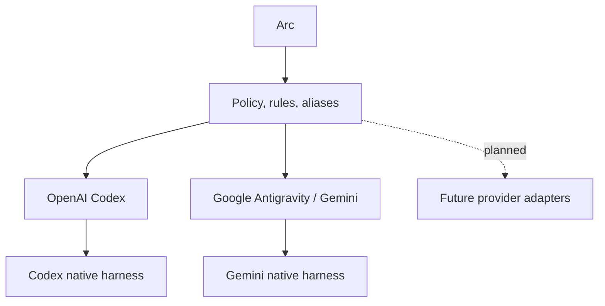
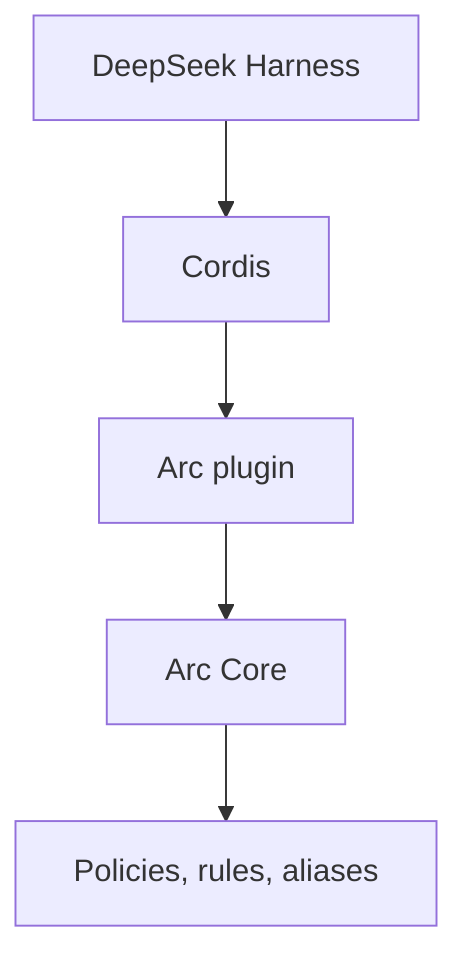
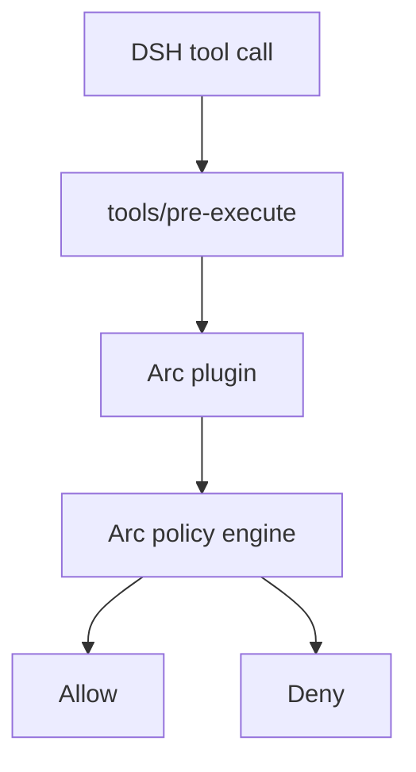
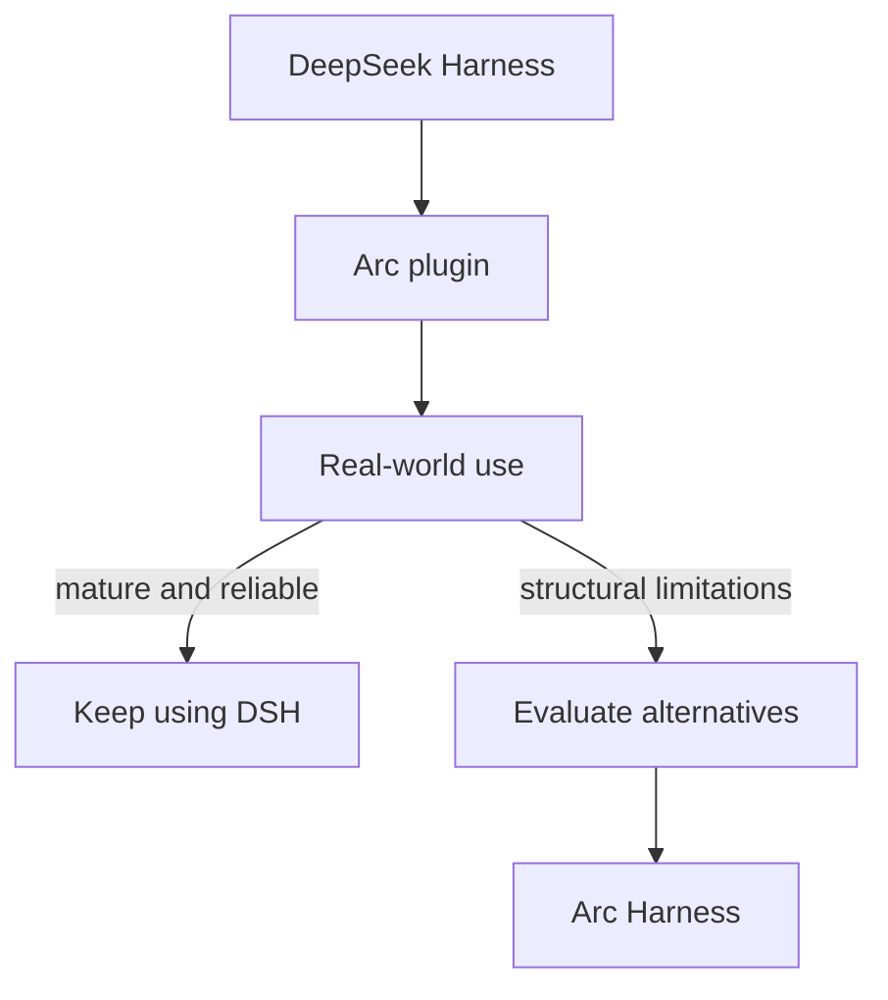
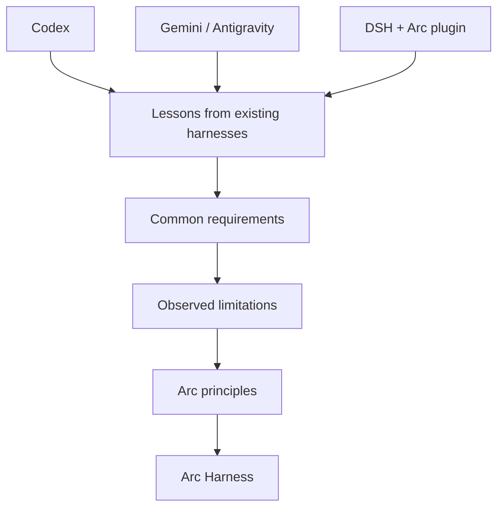
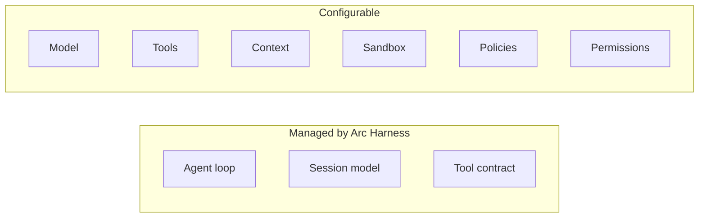
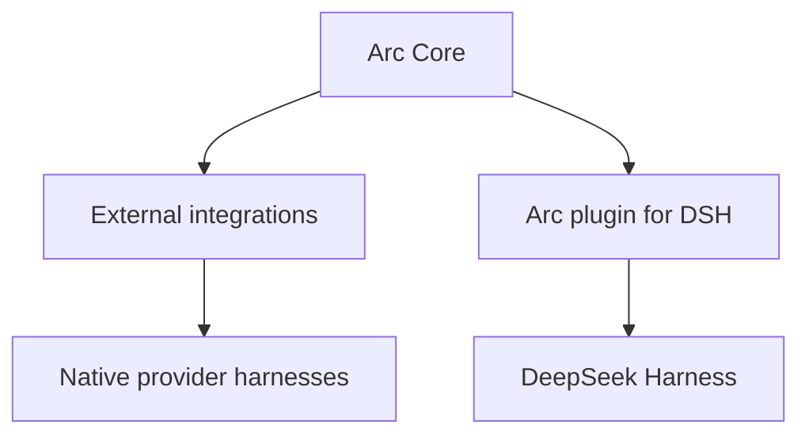
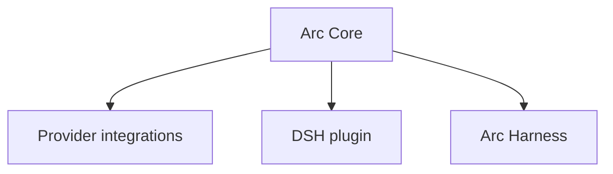
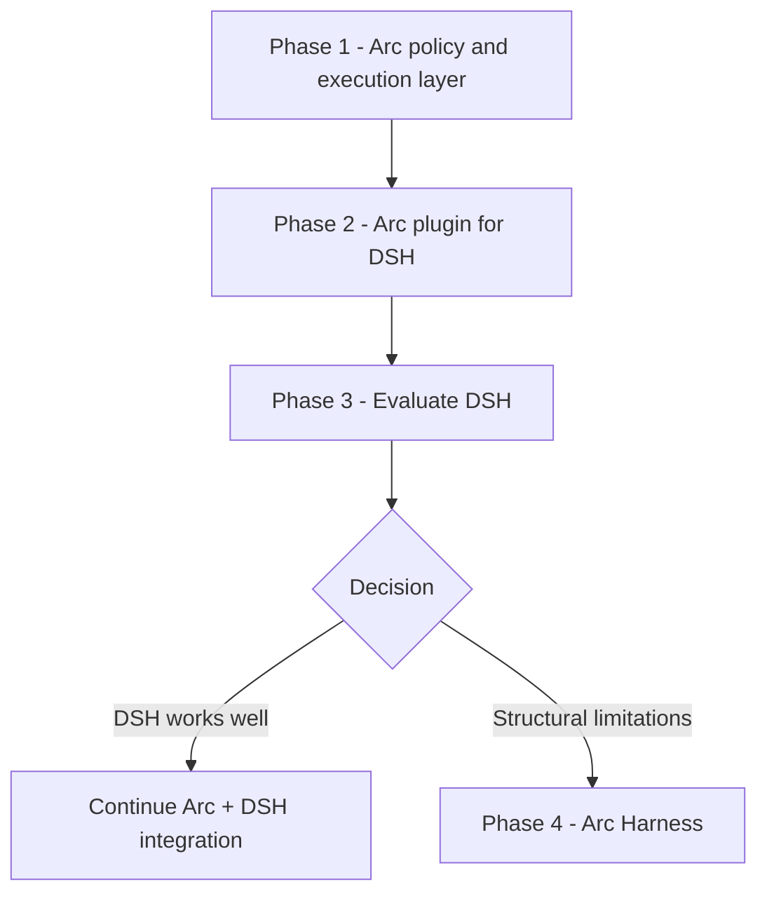

## Arc Development Roadmap

The current release implements the Gemini/Antigravity and OpenAI Codex adapters. The following roadmap is aspirational: the integrations and harnesses described after the current adapters are not compiled targets today.

### Phase 1 — Arc: Policy and Execution Layer for Existing Harnesses

The first phase remains Arc's original purpose.

Arc acts as a policy and execution-control layer for AI agents that already operate within an established harness. Instead of replacing the agent runtime, Arc integrates with the extension mechanisms exposed by each supported platform.

Conceptually:

Arc provides a common policy model while each integration translates Arc's semantics into the capabilities available in the corresponding harness.

This allows developers to define policies independently from a specific agent platform while Arc uses the native capabilities of the two implemented adapters. Additional providers remain roadmap work until an adapter and its capability tests exist.

An important principle of this phase is explicit compatibility.

If a target harness cannot represent a capability required by an Arc policy, Arc should report the incompatibility instead of silently weakening the policy.

This phase establishes the foundations that remain useful throughout the entire roadmap:

- Arc configuration language
- Policies and reusable rules
- Aliases
- Observations and probes
- Policy evaluation
- Runtime enforcement
- Capability detection
- Provider-specific integrations
- Compatibility validation

Arc Core should remain independent from any particular agent harness.

---

### Phase 2 — Arc Plugin for DeepSeek Harness

DeepSeek Harness introduces a different opportunity.

DSH should **not be treated as another Arc compilation target**.

Unlike integrations where Arc adapts itself to an existing provider-specific extension interface, the DSH integration can be implemented directly as a native plugin using the framework and extension architecture provided by DeepSeek Harness itself.

The relationship therefore becomes:

The Arc Plugin would integrate directly with DSH lifecycle events, tool execution checkpoints, guards, and other extension points.

For example:

This integration serves several purposes.

First, it ensures that Arc remains relevant if DeepSeek Harness becomes an important or widely adopted agent platform.

Second, it allows Arc to benefit from DSH capabilities without rebuilding infrastructure that DSH already provides, including its agent loop, tool runtime, sessions, model adapters, subagents, storage, and plugin lifecycle.

Third, and perhaps most importantly, it provides Arc with a real-world environment for studying a highly configurable agent harness.

Arc can observe how DSH evolves and evaluate practical questions such as:

- How stable is its plugin API?
- How difficult are plugin conflicts to diagnose?
- Does extensive configurability create unpredictable compositions?
- How reliable are its security boundaries?
- How effective is its sandbox model?
- How stable is the agent lifecycle?
- How difficult is configuration for normal developers?
- How well does the architecture scale as plugins accumulate?
- How frequently do upstream changes break integrations?
- Does its model abstraction remain sufficiently generic?
- Can strong policy guarantees be maintained inside its plugin architecture?

The Arc Plugin is therefore not merely a fallback integration.

It is a strategic part of the roadmap and a practical research environment for the possible development of Arc's own harness.

---

### Phase 3 — Evaluate DeepSeek Harness

Arc should not immediately build another complete agent harness simply because doing so is technically possible.

Instead, DSH should be evaluated over time.

The project can establish explicit criteria for determining whether an independent Arc Harness is justified.

Examples include:

| Area               | DSH remains suitable          | Arc Harness becomes justified              |
| ------------------ | ----------------------------- | ------------------------------------------ |
| API stability      | Reasonably stable evolution   | Continuous disruptive breaking changes     |
| Plugin system      | Predictable composition       | Frequent or difficult plugin conflicts     |
| Configuration      | Powerful but manageable       | Excessive configuration complexity         |
| Security           | Strong enforcement boundaries | Fundamental enforcement limitations        |
| Sandbox            | Adequate isolation            | Persistent architectural limitations       |
| Agent loop         | Flexible enough               | Important behavior cannot be controlled    |
| Model support      | Effective abstraction         | Provider limitations become structural     |
| Context management | Sufficient control            | Important restrictions remain              |
| Performance        | Acceptable overhead           | Architecture introduces excessive overhead |
| Debugging          | Compositions are observable   | Plugin interactions become opaque          |
| Upstream health    | Actively maintained           | Development stagnates                      |
| Arc integration    | Clean native integration      | Requires increasingly fragile workarounds  |

The decision should therefore be evidence-based.

If DSH becomes mature, stable, secure, and sufficiently configurable, Arc may never need to implement a complete harness.

That would not represent a failure of the roadmap. It would mean that maintaining another agent runtime provides insufficient value compared with integrating Arc into an existing open harness.

---

### Phase 4 — Arc Harness, Only If Necessary

If experience with existing harnesses and DSH reveals significant architectural limitations, Arc can proceed with its own native harness.

At that point, Arc Harness would not be designed from assumptions.

Its architecture would be informed by experience integrating Arc with multiple existing agent systems and by operating Arc as a native DSH plugin.

This gives Arc an opportunity to build a more opinionated harness rather than attempting to maximize extensibility.

DeepSeek Harness follows a highly modular philosophy in which much of the runtime can be replaced or extended through plugins.

Arc Harness could intentionally choose a different tradeoff:

> **Make the important parts configurable without making every fundamental runtime component arbitrarily replaceable.**

The objective would be predictability, strong validation, policy guarantees, and ease of configuration.

For example:

This could provide a simpler configuration surface while maintaining strong architectural guarantees.

---

### Architectural Principle

One principle should remain constant throughout every phase:

> **Arc Core must never depend on a specific agent harness.**

The architecture should preserve clear boundaries:

And potentially, in the future:

Arc Core contains the policy semantics. Harness-specific components implement those semantics using the mechanisms available in their respective environments.

This separation prevents Arc from becoming dependent on the success, failure, or architectural decisions of any single agent platform.

---

### Long-Term Strategy

The roadmap can therefore be summarized as:

This strategy avoids committing Arc to either the success or failure of DeepSeek Harness.

If DSH becomes successful, Arc already has a native integration.

If other native harnesses remain important, Arc continues serving them through its original architecture.

If DSH ultimately proves too complex, unstable, restrictive, or difficult to secure, the experience gained from integrating with multiple harnesses provides the foundation for building Arc Harness.

The key idea is that **Arc Harness is not the immediate destination. It is a strategic option that becomes justified by evidence.**

Each phase therefore reduces the uncertainty of the next:

**Arc → Arc Plugin for DSH → Evaluate → Arc Harness, if necessary.**

---
