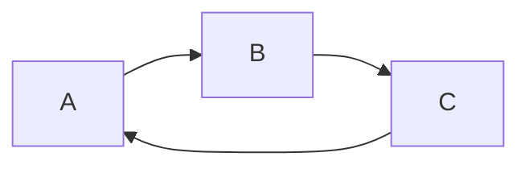
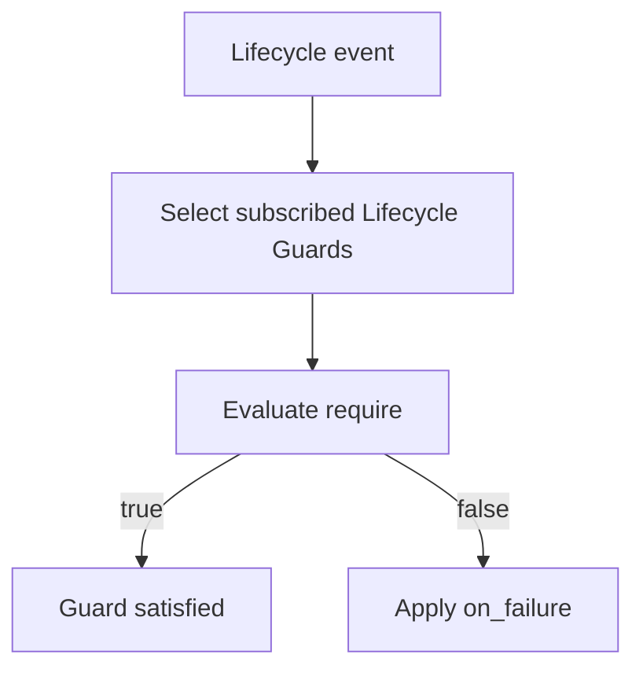
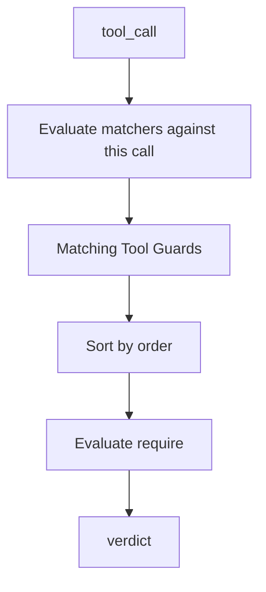
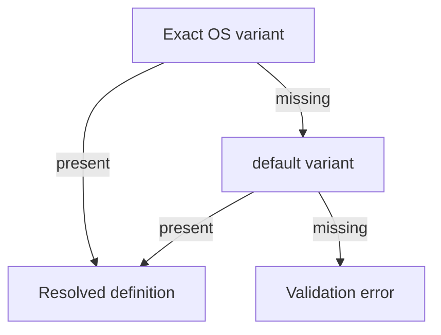
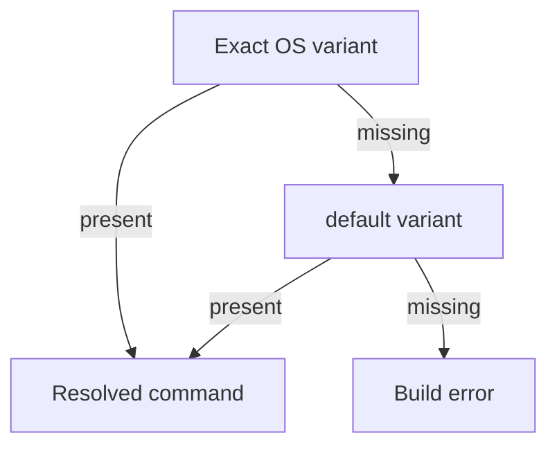

# How to Use Arc

## Contents

- [Introduction](#introduction)
- [Getting started](#getting-started)
- [How-to guides](#how-to-guides)
- [Configuration reference](#configuration-reference)
- [Guards](#guards)
- [Aliases](#aliases)
- [Providers](#providers)
- [Runtime events](#runtime-events)
- [Evaluation order and verdicts](#evaluation-order-and-verdicts)
- [CLI reference](#cli-reference)
- [Troubleshooting](#troubleshooting)
- [Glossary](#glossary)

## Introduction

**Arc** is a provider-agnostic agent configuration compiler with a runtime guard engine.

The current executable registers two provider adapters: Google
Antigravity/Gemini (`gemini`) and OpenAI Codex (`codex`). Other providers may be
discussed as future integrations, but they are not valid build targets until an
emitter and its capability tests are registered.

Arc has two parts: the compiler (`arc build`) reads and validates your workspace and writes the provider files, and the runtime (`arc hook run`) evaluates your Guards each time the provider calls a hook.

For the component model, the validation catalogue and the invariants of schema `1.0`, see [ARCHITECTURE](ARCHITECTURE.md).

This guide goes from a first working Guard to the full reference: start with Getting started, use the How-to guides for a task, and look things up in the Configuration reference, the CLI reference and Providers. Troubleshooting lists the faults you are most likely to meet.

## Getting started

Install Arc and put `arc` on your `PATH` first; the steps are in the README ([Install](../README.md#install)). Then work in an empty directory. The Guard below asks Git a question, so the directory has to be a Git repository:

```bash
git init -q
mkdir arc
echo "Follow the project conventions." > arc/instructions.md
```

Write a manifest with one Guard. It blocks the tool call `git push -f` whenever the command runs inside a Git repository:

```bash
cat > arc.yaml <<'EOF'
schema: '1.0'

root:
  workdir: 'arc'
  instructions: 'instructions.md'

guards:
  tools:
    block_force_push:
      matches:
        exact: 'git push -f'
      require:
        not:
          probe:
            use: 'git rev-parse --is-inside-work-tree'
            in:
              - 'true'
      on_failure:
        action: deny
        feedback: 'Force pushes are not allowed here.'
EOF
```

Compile it for every provider. This writes the provider files next to `arc.yaml` and prints a capability report:

```bash
arc build
```

Now play the part of the provider. Codex calls `arc hook run` with the tool call on `stdin` and reads the verdict on `stdout`:

```bash
echo '{"hook_event_name":"PreToolUse","session_id":"demo","tool_name":"Bash","tool_input":{"command":"git push -f"}}' | arc hook run --event-type pre-tool-use --provider codex --ir-path .codex/arc_ir.json
```

The Guard denies the call. The command prints this on one line and exits `0`:

```json
{"hookSpecificOutput":{"hookEventName":"PreToolUse","permissionDecision":"deny","permissionDecisionReason":"Arc guard feedback:\n\nGuard 'block_force_push':\nConfigured feedback: Force pushes are not allowed here.\nEvaluation findings:\n- negated expression evaluated to true: probe 'git rev-parse --is-inside-work-tree' matched expected value"}}
```

Every hook leaves a trail that you can read afterwards. The first event is `HOOKRECEIVED`:

```bash
arc monitor
```

To use the Guard with a real provider, restart it as described in [Providers](#activation-per-provider). Next: pick a task in the How-to guides, or see [`arc hook run`](#arc-hook-run) for a Gemini example and the payload shapes.

## How-to guides

Each guide is a complete example. Save the manifest as `arc.yaml` in an empty directory; the other files it shows are all it needs, apart from the directory it creates. The manifests build for every provider unless the text says otherwise.

### Block a tool call

A Tool Guard runs when the provider is about to call a tool whose command matches. This one denies a force push while the current branch is `main`.

```bash
mkdir arc
```

```yaml
schema: '1.0'

root:
  workdir: 'arc'

guards:
  tools:
    no_force_push_on_main:
      matches:
        regex: '^git push .*--force.*$'
      require:
        not:
          probe:
            use: 'git rev-parse --abbrev-ref HEAD'
            in:
              - main
      on_failure:
        action: deny
        feedback: |
          Force pushes are not allowed on main.
```

Run `arc build`, then test the Guard with `arc hook run`. The sections [Tool Guard model](#tool-guard-model) and [Matcher grammar](#matcher-grammar) describe `matches` in full.

### Check something at the end of a session

A Lifecycle Guard runs at the start or the end of a session. This one denies the end of the session while the working tree has uncommitted changes.

```bash
mkdir arc
```

```yaml
schema: '1.0'

root:
  workdir: 'arc'

guards:
  lifecycle:
    clean_workspace_at_end:
      trigger: end
      require:
        probe:
          use: 'git status --porcelain'
          in:
            - ''
      on_failure:
        action: deny
        feedback: |
          Commit or stash your changes before finishing.
```

The same Guard with `trigger: start` and `action: deny` works only on Codex. Build it with `--target codex`:

```yaml
schema: '1.0'

root:
  workdir: 'arc'

guards:
  lifecycle:
    clean_workspace_at_start:
      trigger: start
      require:
        probe:
          use: 'git status --porcelain'
          in:
            - ''
      on_failure:
        action: deny
        feedback: |
          Start from a clean working tree.
```

The sections [Precise meaning of `start`](#precise-meaning-of-start) and [Precise meaning of `end`](#precise-meaning-of-end) give the details, and [Providers](#how-arc-capabilities-relates-to-the-table) explains why Gemini cannot block a start.

### Reuse Rules and aliases

A reusable Rule lives in `rules.yaml` and an alias gives a command a name. Both are convention files inside `workdir`, found by name. Here the Rule `valid.state` is reused by the Rule `force_push.allowed`, and two aliases name a matcher and a probe command.

```bash
mkdir arc
```

```yaml
# arc/aliases.yaml
schema: '1.0'

matchers:
  git.push.force:
    default:
      regex: '^git push .*--force.*$'

operations:
  git.branch.current:
    default: 'git rev-parse --abbrev-ref HEAD'
```

```yaml
# arc/rules.yaml
schema: '1.0'

rules:
  valid.state:
    not:
      probe:
        use:
          alias: git.branch.current
        in:
          - main

  force_push.allowed:
    rule: valid.state
```

The manifest refers to both by name. `rules.yaml` is required because a Rule is referenced, and `aliases.yaml` because an alias is. If neither is referenced, both files may be absent.

```yaml
schema: '1.0'

root:
  workdir: 'arc'

guards:
  tools:
    protected_force_push:
      matches:
        alias: git.push.force
      require:
        rule: force_push.allowed
      on_failure:
        action: deny
        feedback: |
          This force push is not allowed.
```

See [Reusable Rules](#reusable-rules-rulesyaml) and [Alias model](#alias-model).

### Split the configuration into modules

A module moves one normal section, here `guards`, into its own file. The manifest names the file under `modules`:

```bash
mkdir arc
```

```yaml
# arc/guards.yaml
schema: '1.0'

guards:
  tools:
    block_force_push:
      matches:
        regex: '^git push .*--force.*$'
      require:
        not:
          probe:
            use: 'git rev-parse --abbrev-ref HEAD'
            in:
              - main
      on_failure:
        action: deny
        feedback: |
          Force pushes are not allowed on main.
```

```yaml
schema: '1.0'

root:
  workdir: 'arc'

modules:
  guards: 'guards.yaml'
```

A section cannot be both inline and a module. See [Modules](#modules).

### Ask the user before a tool runs

With `action: ask`, Arc holds the tool call and shows an Allow or Deny dialog instead of blocking outright. This Guard asks before a `kubectl apply` while the branch is `main`.

```bash
mkdir arc
```

```yaml
schema: '1.0'

root:
  workdir: 'arc'

guards:
  tools:
    confirm_apply_on_main:
      matches:
        regex: '^kubectl apply .*$'
      require:
        not:
          probe:
            use: 'git rev-parse --abbrev-ref HEAD'
            in:
              - main
      on_failure:
        action: ask
        feedback: |
          Confirm this apply on main in the Arc decision UI.
```

The dialog is an Arc window, so it needs a display and the `arc-decision-ui-host` program next to `arc`. To preview a dialog, run [`arc decision ask`](#arc-decision-ask). A dialog that is closed, times out or fails is unresolved: it is never read as an approval. See [Troubleshooting](#troubleshooting) when no dialog appears, and [Providers](#providers) for which events can ask.

### Build for several providers and operating systems

`arc build` compiles for every provider and every operating system by default. Narrow either selector with a comma list or by repeating the flag:

```bash
arc build --target codex --os host
arc build --target gemini,codex --os windows,linux
arc build --target gemini --target codex --os windows --os linux
```

Aliases can have one variant per operating system, so `--os` decides which variant is compiled into the hooks. The files written are listed in [Providers](#generated-files-per-provider) and the options in [`arc build`](#arc-build).

### Watch what the hooks do

`arc monitor` reads the journal that every `arc hook run` writes. Use it to see whether the provider ran the hook and why a Guard decided as it did.

```bash
arc monitor --latest
arc monitor --follow --workspace .
arc monitor --level warn --format json
arc monitor --events HookFailed
```

No `HOOKRECEIVED` event means the provider did not run the hook. Look at `HookFailed` and `CapabilityDegraded` first when a result surprises you. All options and event names are in [`arc monitor`](#arc-monitor).

## Configuration reference

The sections below describe every field of schema `1.0`: the manifest and its files, Rules, Guards, aliases and the events and verdicts the runtime produces. [Providers](#providers) sits in the middle of them because it describes what each provider can enforce for the Guards defined before it. The command line is in the [CLI reference](#cli-reference).

### Schema definition (`1.0`)

Arc finds its root configuration file by the name:

```text
arc.yaml
```

(`arc build --path` also accepts a manifest with another name; see the CLI reference.) The file must declare its schema version. This is the smallest useful manifest, with the two files it needs:

```bash
mkdir arc
touch arc/instructions.md
```

```yaml
schema: '1.0'

root:
  workdir: 'arc'
  instructions: 'instructions.md'
```

Save it as `arc.yaml` next to the `arc/` directory and run `arc build`.

For schema `1.0`, these are all the fields that exist. Any other key fails the build with `unknown field`:

| Field | Required | Meaning | Section |
| --- | --- | --- | --- |
| `schema` | yes | Schema version, `'1.0'` | this section |
| `root` | yes | Workspace boundary and entry instructions | `workdir` |
| `root.workdir` | yes | Directory that holds every Arc-managed file | `workdir` |
| `root.instructions` | no | Entry instruction document inside `workdir` | Root configuration |
| `runtime` | no | Runtime settings | Convention files |
| `runtime.decision_timeout_seconds` | no | Deadline of an interactive decision, default `300` | Convention files |
| `modules` | no | Moves a normal section into its own file | Modules |
| `skills` | no | Reusable instruction resources | Skills |
| `roles` | no | Catalog of role descriptors | Roles |
| `guards` | no | Runtime enforcement declarations | Guard model |

Fields or sections not defined by this document are not part of the documented `1.0` contract.

---

### Workspace and path resolution

#### `workdir`

`root.workdir` defines the Arc workspace boundary and the base used to resolve Arc-managed paths.

If `workdir` is relative, it is resolved from the manifest directory, which is the directory that contains `arc.yaml`. The directory where you run `arc build` plays no part. A relative `workdir` such as `../other` may point outside the manifest directory. Generated files are written next to `arc.yaml`, in that same manifest directory, unless you pass `--output-dir`.

Example. The manifest is `sub/arc.yaml` and `arc build` runs from the parent directory:

```bash
mkdir -p sub/ws
printf "schema: '1.0'\n\nroot:\n  workdir: 'ws'\n" > sub/arc.yaml
arc build --path sub/arc.yaml --target codex
ls sub
```

```text
manifest directory: ./sub
workdir:            ws
resolved workdir:   ./sub/ws       (not ./ws)
output root:        ./sub          (AGENTS.md, .codex/ and .arc/ appear here)
```

If `sub/ws` does not exist, the build stops with `Specified workdir "ws" does not exist (resolved to "sub\ws")`, even when a `ws` directory exists in the current directory.

After `workdir` is resolved, Arc-managed paths are resolved inside that directory, including:

- `root.instructions`;
- declared module files;
- skill sources;
- role sources;
- `rules.yaml`;
- `aliases.yaml`;
- future Arc file references that explicitly use the same path contract.

#### Workspace containment

All Arc-managed resources must remain inside the resolved `workdir`.

The following are invalid:

- a relative path that escapes `workdir` using `..`;
- an absolute path that points outside `workdir`;
- any path component that is a symlink, junction, or other filesystem reparse point, even when its resolved destination remains inside `workdir`;
- a path whose canonical/resolved destination escapes `workdir` through filesystem indirection.

Arc rejects filesystem indirection before using Arc-managed resources, then validates containment against the final resolved path as well as the textual path.

For clarity, examples use workspace-relative paths:

```yaml
src: 'skills/python'
```

rather than operating-system absolute paths.

---

### Root configuration

The examples in this section need this directory and file next to `arc.yaml`:

```bash
mkdir arc
touch arc/instructions.md
```

A minimal Arc configuration is:

```yaml
schema: '1.0'

root:
  workdir: 'arc'
```

An instructions file may also be declared:

```yaml
schema: '1.0'

root:
  workdir: 'arc'
  instructions: 'instructions.md'
```

`instructions` is the provider-agnostic entry instruction document.

A target compiler may translate or reference it using a provider-specific instruction entry point such as `AGENTS.md`.

The generated filename and location are target-specific.

#### Source workspace, output, and `.arc/` state

`root.workdir` is an input boundary. `arc build` reads configuration, rules,
aliases, roles, and skill sources from it; it does not rewrite or remove those
sources.

The output root is the directory containing `arc.yaml` by default, or the
directory selected with `--output-dir`. Arc keeps its generated integrity and
recovery state under that output root:

```text
.arc/
├── arc-capabilities.json
├── build_manifest.json
├── build.lock
├── build-transaction.json   # only while a transaction is pending
└── build-cleanup.json       # only while cleanup recovery is pending
```

Provider-discovered artifacts still use provider-required locations such as
`.codex/` and `.agents/`. `.arc/` should be ignored by version control. A build
must not silently edit an existing `.gitignore`.

---

### Convention files

Arc schema `1.0` recognizes three conventionally discovered configuration files:

```text
arc.yaml
<workdir>/rules.yaml
<workdir>/aliases.yaml
```

`arc.yaml` is required.

`rules.yaml` and `aliases.yaml` are optional and are **not declared through `modules`**.

#### `runtime`

`runtime` is an optional section of `arc.yaml`, not a convention file. It has one field, `runtime.decision_timeout_seconds`, the deadline of an Arc-owned interactive decision. Without `runtime`, the deadline is 300 seconds (the default). To change it:

```bash
mkdir arc
```

```yaml
schema: '1.0'

root:
  workdir: 'arc'

runtime:
  decision_timeout_seconds: 300
```

The numbers involved:

| Value | Seconds | Meaning |
| --- | --- | --- |
| Default `decision_timeout_seconds` | 300 | Deadline of the dialog when `runtime` is absent |
| `decide` evaluation budget | 180 | Time the model-backed `decide` evaluation may use |
| Provider hook termination grace | 5 | Grace added so the hook can finish and terminate |
| Default provider hook timeout | 485 | 300 + 180 + 5, the timeout written into the provider hook |
| Maximum `decision_timeout_seconds` | 86215 | Valid values are `1` through `86215`; the provider hook timeout maximum is 86400 and 86400 - 180 - 5 = 86215 |

A value outside `1` through `86215` fails the build with `runtime: decision timeout must be between 1 and 86215 seconds`.

Arc embeds the dialog deadline in the compiled IR and emits provider hook timeouts with room for evaluation, the dialog, and the termination grace. The hook timeout is the configured deadline plus 185 seconds. Expiration is not user consent or denial. Arc records a timed-out, closed, or failed dialog as `Unresolved`. For
a tool call, the adapter blocks that exact attempt so control returns to the
agent; a later attempt is evaluated again. For `end`/`Stop`, the adapter keeps
the agent active and evaluates the guard again at the next stop event.
Lifecycle `start` guards cannot use `on_failure.action: ask`, because there is
no established agent loop to which an unresolved decision can portably return.

#### `rules.yaml`

Arc automatically looks for:

```text
<workdir>/rules.yaml
```

The file contains reusable boolean Rules.

Its absence is valid when no external Rule is referenced.

```text
rules.yaml absent
+
no external rule references
=
valid
```

If a Guard or another Rule references an external Rule and `rules.yaml` does not exist:

```text
validation error
```

A user is never required to create `rules.yaml` merely to write a one-off condition. Guards may contain inline Rule expressions.

#### `aliases.yaml`

Arc automatically looks for:

```text
<workdir>/aliases.yaml
```

The file contains reusable low-level matcher and operation aliases.

Its absence is valid when no alias is referenced.

```text
aliases.yaml absent
+
no alias references
=
valid
```

If any alias is referenced and `aliases.yaml` does not exist:

```text
validation error
```

Inline matchers and inline probe operations remain valid where their grammar permits them.

#### Schema equality

When present, both convention files must use the same schema version as `arc.yaml`:

```text
rules.yaml.schema   == arc.yaml.schema
aliases.yaml.schema == arc.yaml.schema
```

A mismatch is a validation error.

---

### Modules

Normal Arc sections may be declared inline in `arc.yaml` or split into explicitly declared module files.

Example. It needs the directory tree below, the three module files shown after it, and nothing else:

```bash
mkdir -p arc/skills/python
touch arc/instructions.md
echo "# Python" > arc/skills/python/SKILL.md
```

```yaml
schema: '1.0'

root:
  workdir: 'arc'
  instructions: 'instructions.md'

modules:
  skills: 'skills.yaml'
  roles: 'roles.yaml'
  guards: 'guards.yaml'
```

This is `arc/skills.yaml`:

```yaml
# arc/skills.yaml
schema: '1.0'

skills:
  python:
    description: Python development
    src: 'skills/python'
```

This is `arc/roles.yaml`:

```yaml
# arc/roles.yaml
schema: '1.0'

roles:
  python_dev:
    description: Python development role.
```

This is `arc/guards.yaml`. It builds for every target, because its only lifecycle trigger is `end` and its tool Guard uses an inline matcher:

```yaml
# arc/guards.yaml
schema: '1.0'

guards:
  lifecycle:
    clean_workspace_at_end:
      trigger: end
      require:
        probe:
          use: 'git status --porcelain'
          in:
            - ''
      on_failure:
        action: deny
        feedback: |
          Commit or stash your changes before finishing.

  tools:
    block_force_push:
      matches:
        regex: '^git push .*--force.*$'
      require:
        not:
          probe:
            use: 'git rev-parse --abbrev-ref HEAD'
            in:
              - main
      on_failure:
        action: deny
        feedback: |
          Force pushes are not allowed on main.
```

Module paths are resolved inside `workdir`.

`rules.yaml` and `aliases.yaml` are not module entries. They are convention files defined in the Convention files section.

#### No implicit merge

A normal section cannot be declared both inline and through `modules`.

To try the next example, put the `arc/` directory and an `arc/skills.yaml` file in place, so that the duplicate is the only fault:

```bash
mkdir -p arc/skills/python
echo "# Python" > arc/skills/python/SKILL.md
```

```yaml
# arc/skills.yaml
schema: '1.0'

skills:
  python:
    description: Python development
    src: 'skills/python'
```

This is invalid:

```yaml
schema: '1.0'

root:
  workdir: 'arc'

modules:
  skills: 'skills.yaml'

skills:
  python:
    description: Python development
    src: 'skills/python'
```

Arc rejects this as a duplicate section definition and the build exits non-zero.

There is no implicit merge and neither source overrides the other.

#### Module file contract

A normal module file must contain:

1. `schema`;
2. exactly the section represented by that module.

Example `skills.yaml`:

```yaml
schema: '1.0'

skills:
  python:
    description: Python development
    src: 'skills/python'
```

For schema `1.0`:

```text
module.schema == arc.yaml.schema
```

A mismatch is a validation error.

---

### Skills

`skills` defines reusable instruction resources available to the generated agent configuration.

A leaf skill references a source directory inside `workdir`. Each field is required: `description` and `src`. The source directory must contain a `SKILL.md` or a `README.md`; without one the build stops with `is a directory, but does not contain a 'SKILL.md' or 'README.md' file`. This example needs these directories and files:

```bash
mkdir -p arc/skills/python arc/skills/javascript-dev
echo "# Python" > arc/skills/python/SKILL.md
echo "# JavaScript" > arc/skills/javascript-dev/SKILL.md
```

```yaml
schema: '1.0'

root:
  workdir: 'arc'

skills:
  python:
    description: Python development conventions and practices
    src: 'skills/python'

  javascript:
    description: JavaScript development conventions and practices
    src: 'skills/javascript-dev'
```

The key is the Arc identifier of the skill. It does not have to match the source directory name.

The target compiler is responsible for materializing the source according to the selected provider's skill format.

#### Skill groups

Skills may be organized recursively using `members`. A group has `members` and may have a `description`; each leaf inside it has `description` and `src`. The example needs these directories:

```bash
mkdir -p arc/skills/rust-dev/testing
mkdir -p arc/skills/rust-dev/anti-patterns/struct
mkdir -p arc/skills/rust-dev/anti-patterns/testing
echo "# Testing" > arc/skills/rust-dev/testing/SKILL.md
echo "# Struct" > arc/skills/rust-dev/anti-patterns/struct/SKILL.md
echo "# Testing anti-patterns" > arc/skills/rust-dev/anti-patterns/testing/SKILL.md
```

```yaml
schema: '1.0'

root:
  workdir: 'arc'

skills:
  rust_dev:
    description: Rust development skills
    members:
      testing:
        description: Rust testing practices
        src: 'skills/rust-dev/testing'

      anti_patterns:
        members:
          struct:
            description: Struct anti-patterns
            src: 'skills/rust-dev/anti-patterns/struct'

          testing:
            description: Testing anti-patterns
            src: 'skills/rust-dev/anti-patterns/testing'
```

Groups are organizational. A leaf skill is the element that points to a source resource.

#### Name normalization and collisions

Arc emits every leaf skill into one flat provider namespace. Each declaration
segment is converted to lowercase ASCII kebab-case and recursive group
segments are joined with `-`. The canonical name is used both for the provider
folder and for the skill frontmatter `name`.

For example:

```text
skills.rust_dev.members.testing                 -> rust-dev-testing
skills.rust_dev.members.anti_patterns.struct    -> rust-dev-anti-patterns-struct
```

Normalization must never silently merge different Arc entities.

If two identifiers normalize to the same target identifier, validation fails.

Example:

```text
anti_patterns -> anti-patterns
anti-patterns -> anti-patterns
```

Arc reports the collision. It does not overwrite, reorder, or silently rename either entity.

Collisions are checked after constructing the complete canonical leaf name.
Consequently, both of these pairs are invalid:

```text
skills.rust-dev
skills.rust.members.dev

skills.rust-dev.members.test
skills.rust.members.dev-test
```

Alias identifiers are an explicit exception: alias identifiers are literal and are not normalized by Arc.

---

### Roles

`roles` is a catalog of role descriptors that may be consumed by generated agent configurations.

The example needs one file, because `project_manager` declares a `src`:

```bash
mkdir -p arc/roles
echo "# Project manager" > arc/roles/project-manager.md
```

```yaml
schema: '1.0'

root:
  workdir: 'arc'

roles:
  python_dev:
    description: |
      Python development role.

  project_manager:
    description: |
      Project management role and a compact summary of its responsibilities.
    src: 'roles/project-manager.md'
```

`description` provides the role descriptor or a compact summary useful for context selection.

`src` is optional:

- without `src`, `description` is the complete role descriptor;
- with `src`, `description` acts as a summary and `src` points to the complete descriptor inside `workdir`.

---

### Rule model

A **Rule** is a boolean expression.

Conceptually:

```text
RuleExpression -> true | false
```

Rules contain reusable or inline decision logic.

A Rule does **not**:

- define when it runs;
- subscribe to provider events;
- wait for future events;
- match tool calls;
- contain an enforcement action;
- block the provider by itself.

A Rule is evaluated only because:

1. a Guard currently requires it; or
2. another Rule references it.

This separation is intentional:

```text
Guard
    decides WHEN a requirement matters.

Rule
    decides WHETHER the requirement is satisfied.
```

---

### Rule expressions

A Rule expression is not a file of its own. The expression examples in this part, and in the `probe` and `decide` sections, are the value of `require:` in a Guard or of a Rule in `rules.yaml`. Complete files that build, with a Guard around them, are in the Guard structure and Tool Guard model sections.

Schema `1.0` defines the following Rule-expression primitives:

```text
probe

decide

rule reference

all

any

not
```

Conceptually:

```text
RuleExpression :=
      Probe
    | Decide
    | RuleReference
    | All
    | Any
    | Not
```

#### `all`

`all` evaluates child Rule expressions in YAML order.

All children must be true.

Short-circuit rule:

```text
stop on first false
```

Example:

```yaml
all:
  - probe:
      use:
        alias: git.branch.current
      in:
        - dev

  - decide:
      prompt: |
        Is this operation explicitly authorized?
```

#### `any`

`any` evaluates child Rule expressions in YAML order.

At least one child must be true.

Short-circuit rule:

```text
stop on first true
```

#### `not`

`not` accepts exactly one Rule expression and negates its result.

Example:

```yaml
not:
  probe:
    use:
      alias: git.branch.current
    in:
      - main
```

#### Ordering is observable

Rule ordering matters because later expressions may perform active work.

For example:

```yaml
all:
  - rule: cheap.deterministic.check
  - probe: ...
  - decide: ...
```

may avoid both the probe and the model-backed decision when the first expression is false.

`probe` leaves run as the plan traversal reaches them. A reached `decide` has no
boolean result until the scheduler returns, so later children may also be
evaluated or queued during that planning pass. Do not assume that every child
waits for a preceding `decide` response before doing work.

---

### Reusable Rules (`rules.yaml`)

Reusable Rules are declared under `rules` in `<workdir>/rules.yaml`.

#### File contract

When present, `rules.yaml` may contain only:

```text
schema
rules
```

Example:

```yaml
schema: '1.0'

rules:
  valid.state:
    not:
      probe:
        use:
          alias: git.branch.current
        in:
          - main
```

`schema` is required and must equal `arc.yaml.schema`.

`rules` contains named reusable Rule expressions.

A `rules.yaml` file with unrelated Arc sections is invalid.

#### Reusable Rule definitions

Example:

```yaml
schema: '1.0'

rules:
  valid.state:
    not:
      probe:
        use:
          alias: git.branch.current
        in:
          - main

  explicitly.authorized:
    decide:
      prompt: |
        Is this operation explicitly authorized by the user's request?

  protected.operation.allowed:
    all:
      - rule: valid.state
      - rule: explicitly.authorized
```

Each reusable Rule identifier resolves to exactly one Rule expression.

#### Rule references

A reusable Rule is referenced with:

```yaml
rule: valid.state
```

A Rule may reference another Rule.

Example:

```yaml
rules:
  safe.operation:
    all:
      - rule: valid.state
      - rule: explicitly.authorized
```

#### Rule dependency graph

Rule references form a directed dependency graph.

Arc validates this graph before compilation.

Cycles are invalid.

Example:



must fail validation.

#### Missing `rules.yaml`

If no external Rule reference exists, `rules.yaml` may be absent.

If any external Rule reference exists and `rules.yaml` is absent, validation fails.

---

### Inline Rules

A Guard may declare a Rule expression directly in `require`.

This avoids forcing users to create a reusable Rule for one-off logic.

Example:

```yaml
require:
  not:
    probe:
      use:
        alias: git.branch.current
      in:
        - main
```

Inline and reusable Rules have identical boolean semantics.

The difference is only declaration and reuse.

A Guard may therefore use either:

```yaml
require:
  rule: valid.state
```

or:

```yaml
require:
  not:
    probe:
      use:
        alias: git.branch.current
      in:
        - main
```

---

### `probe`

`probe` is a Rule primitive that obtains active environment evidence.

Example:

```yaml
probe:
  use: 'git rev-parse --abbrev-ref HEAD'
  in:
    - main
    - master
    - dev
```

Abstract semantics:

```text
probe_result in configured_values
```

The probe is executed only when Rule evaluation reaches that node.

A probe does not run continuously and is not scheduled merely because the Rule exists.

A target does not silently reinterpret a probe in a way that changes its boolean meaning.

#### Operation alias form

A probe may use a reusable operation alias:

```yaml
probe:
  use:
    alias: git.branch.current
  in:
    - main
    - master
```

The reference resolves exclusively against the `operations` namespace in `aliases.yaml`.

For every selected OS, it must resolve to exactly one command string.

---

### `decide`

`decide` is a Rule primitive that delegates a boolean semantic assessment to the model.

Example:

```yaml
decide:
  prompt: |
    Is this operation explicitly authorized by the user's request?
```

The model-facing result is:

```text
true | false
```

A target may wrap or transform the prompt to reliably obtain a boolean response, provided that it preserves the requested decision semantics. Arc supplies a normalized `current_operation` separately from transcript-derived session context. Missing session intent or missing current operation fails closed without invoking the model.

Arc also gives the evaluator the facts it already established during the current event, which are the matchers and probes that actually ran and their results, together with the session context of the current provider. The evaluator treats those facts as Arc-attested and cannot override them. If the session intent or the current operation is missing, `decide` fails closed without calling the model. The exact evidence and transcript rules are in [ARCHITECTURE](ARCHITECTURE.md#decision-evaluation).

For a `ToolCall`, `true` means only that the semantic assessment passed. It does
not authorize execution. Arc still obtains a deterministic user decision
for that exact pending operation. A provider-native confirmation may be used
when available; otherwise Arc may use a declared `Emulated` decision transport.
If no valid transport exists, the tool call is denied.

For lifecycle checks, the boolean remains a semantic completion assessment;
the provider capability matrix determines whether the resulting lifecycle
behavior is native, emulated, partial, or unsupported.

Provider-specific model calls, structured output, tool schemas, retries, parsing, and transport are implementation details.

The authenticated IDE session is not assumed to authenticate a separately
launched provider CLI. If `decide` requires a provider process and no runnable,
authenticated CLI (or explicit `ARC_LLM_CLI`) is available, the semantic
evaluation fails closed. In particular, a packaged Codex Desktop executable is
not equivalent to an installed Codex CLI.

#### Hook feedback and decision UI

Codex and Gemini hooks still receive the provider-required JSON response on
`stdout`. That outer JSON is the hook protocol. Arc's feedback field inside
that response contains bounded, human-readable feedback for the failed Guards.
For each Guard, Arc keeps configured feedback and auditor findings as separate
labeled lines when both exist. Evaluation faults use generic descriptions. The
hook does not include the internal failure-bundle YAML, fingerprints, invocation
metadata, raw evidence, or artifact references in model context. Feedback above
the 16 KiB limit fails closed instead of being truncated or moved to an
artifact.

An interactive decision request carries a decision prompt in `summary`, and
optional `configured_feedback` and `auditor_findings` as separate fields. The UI
renders each separately; configured feedback does not replace the auditor's
findings. It shows the auditor's explanation instead of the internal
`true`/`false` decision boolean. Exact-operation authorization remains
a separate user choice: semantic `decide: true` does not authorize the pending
operation, and the user must still choose `Allow` or `Deny`.

For a Guard whose probes ran and failed, the request also lists them in `failed_probes`, each with the innermost reusable rule name (if any), the command, and the reason when the probe failed through `not`, never an expected value, and a Guard that faulted still fails closed without a dialog.

When a successful semantic `decide` includes findings, Arc preserves them with
the Guard's satisfied attributions and shows them under that Guard's required
authorization. A Guard failure shows its configured feedback and failure
findings independently.

---

## Guards

### Guard model

A **Guard** is a runtime enforcement declaration.

A Guard connects:

```text
activation
+
requirement
+
failure action
```

Conceptually:

```text
Guard {
    activation
    require: RuleExpression
    on_failure
}
```

A Guard asks:

> At this runtime event, what must be true for the current provider operation to continue?

For schema `1.0`, Arc distinguishes two semantically exclusive Guard categories:

```text
Lifecycle Guard
Tool Guard
```

They are separate because their activation mechanisms are different.

---

### Guard structure

Guards are declared under the normal Arc `guards` section.

`guards` has two keys, `lifecycle` and `tools`. Each maps a Guard name to its declaration. Both the Guard names and the Rule and alias names they use are your choice.

Example. This one uses a reusable Rule and aliases, so it needs three files in `arc/`: first the directory and the entry instructions, then `rules.yaml` and `aliases.yaml`:

```bash
mkdir arc
touch arc/instructions.md
```

```yaml
# arc/rules.yaml
schema: '1.0'

rules:
  valid.state:
    not:
      probe:
        use:
          alias: git.branch.current
        in:
          - main

  force_push.allowed:
    rule: valid.state
```

```yaml
# arc/aliases.yaml
schema: '1.0'

matchers:
  git.push.force:
    default:
      regex: '^git push .*--force.*$'

operations:
  git.branch.current:
    default: 'git rev-parse --abbrev-ref HEAD'
```

This `arc.yaml` builds for every target. The lifecycle Guard uses `end`; a `start` Guard with `deny` is limited to Codex and is shown in the section on `start`:

```yaml
schema: '1.0'

root:
  workdir: 'arc'
  instructions: 'instructions.md'

guards:
  lifecycle:
    safe_end:
      trigger: end
      require:
        rule: valid.state
      on_failure:
        action: deny
        feedback: |
          Invalid repository state.

  tools:
    protected_force_push:
      matches:
        alias: git.push.force
      require:
        rule: force_push.allowed
      on_failure:
        action: deny
        feedback: |
          This force push is not allowed.
```

`guards` may be declared inline in `arc.yaml`, as above, or externalized through the normal module mechanism. The `modules` entry is `guards: 'guards.yaml'`, and the `guards.yaml` file holds `schema` and `guards` with the same `lifecycle` and `tools` keys; a complete one is in the Modules section.

`rules.yaml` and `aliases.yaml` remain independent convention files and are never declared here.

---

### `require`

`require` is the Rule expression that must evaluate to `true` for a Guard to be satisfied.

Reusable Rule:

```yaml
require:
  rule: valid.state
```

Inline Rule:

```yaml
require:
  not:
    probe:
      use:
        alias: git.branch.current
      in:
        - main
```

Semantics:

```text
require == true
    -> Guard satisfied

require == false
    -> Guard failed
    -> apply on_failure
```

---

### `on_failure`

`on_failure` defines the Guard behavior when `require` evaluates to `false`.

For schema `1.0`, the defined actions are:

```yaml
on_failure:
  action: deny
```

`ask` and `message` are also valid:

```yaml
on_failure:
  action: ask
  feedback: |
    Confirm this operation in the Arc decision UI.
```

```yaml
on_failure:
  action: message
  feedback: |
    This event requires attention before continuing.
```

`deny` applies the selected provider's terminal response to the current guarded
event. For a tool call that response blocks the exact call; lifecycle `end`
responses follow the provider's Stop contract described in the provider capability model. `ask`
requires a verified native or Arc-managed decision transport and may hold the
current event while it is resolved. `message` is advisory and never blocks.

`action: ask` is invalid on a lifecycle guard whose trigger set contains
`start`, for every provider. Use `deny` when the start transport can prevent
the session, or `message` for an explicitly advisory start guard.

Feedback is optional for every action:

```yaml
on_failure:
  action: deny
  feedback: |
    This operation is blocked by Arc.
```

Unknown actions are rejected by schema validation. A future schema version may
add actions, but it must not silently reuse `deny` with a different meaning.

---

### Meaning of `deny`

`deny` has one invariant meaning:

> Prevent the provider operation currently guarded by this evaluation from proceeding.

It does not mean:

- globally invalidate the session forever;
- block all subsequent provider operations;
- keep a Guard active until some environment state changes;
- retroactively undo an operation that already occurred;
- reinterpret a completed response as preventable.

The effect is scoped to the current guarded operation.

If no Guard fails with `deny`, Arc adds no `Deny` disposition. A matching
`ask` can still hold the event for a decision, and a runtime fault still fails
closed.

#### Natural remediation

Suppose a Tool Guard prevents force pushing while the repository is on `main`.

The agent attempts:

```text
git push --force
```

Arc denies that current tool call.

The agent may subsequently attempt:

```text
git switch dev
```

That is a different ToolCall. If it does not match the force-push Guard, the previous denial does not block it.

This preserves the agent's ability to remediate its own state.

---

### Guard `order`

`order` controls Guard evaluation order when several Guards are activated by the same current provider operation.

- lower values are evaluated first;
- higher values are evaluated later;
- valid range: `0..100`;
- default: `0`;
- `order` is evaluation order only, not semantic authority.

For equal `order`, Arc preserves YAML declaration order. Arc evaluates every
matched Guard in the event batch, including Guards after one that fails with
`deny`; it then reduces the complete report. `Deny` wins disposition
precedence, but does not short-circuit evaluation of sibling Guards.

---

### Lifecycle Guard model

A Lifecycle Guard is activated by a lifecycle event.

Example. It uses an inline Rule, so it needs only the `arc/` directory:

```bash
mkdir arc
```

```yaml
schema: '1.0'

root:
  workdir: 'arc'

guards:
  lifecycle:
    safe_end:
      trigger: end
      require:
        not:
          probe:
            use: 'git rev-parse --abbrev-ref HEAD'
            in:
              - main
      on_failure:
        action: deny
        feedback: |
          The session cannot finish from the current state.
```

This Guard builds for every target. A `start` Guard with `deny` is limited to Codex; see the section on `start`.

Runtime behavior:



A Lifecycle Guard is evaluated for that event occurrence only.

It does not remain waiting for later tool calls.

---

### Lifecycle triggers

Schema `1.0` defines the following Lifecycle Guard triggers:
 
| Trigger | Logical point |
| --- | --- |
| `start` | Initial Arc-visible session boundary before normal session work proceeds (turn 1) |
| `end` | Final Arc-visible lifecycle boundary before Arc releases the session |
 
`tool_call` is intentionally **not** a Lifecycle Guard trigger.
 
Tool calls are handled by Tool Guards.
 
A Guard may declare one trigger:
 
```yaml
trigger: start
```
 
or multiple lifecycle triggers:
 
```yaml
trigger:
  - start
  - end
```
 
The list uses OR semantics.
 
Each occurrence is a separate Guard activation.
 
It does not mean Arc waits until all listed lifecycle events have happened.
 
---
 
### Precise meaning of `start`
 
`start` is a point event evaluated at the initial session boundary (turn 1).
 
It does not mean:
 
> Begin observing the provider until something interesting happens.
 
Generated provider hooks deliver supported events to `arc hook run`; Arc does
not independently poll the provider or watch its session.
 
`start` means conceptually:
 
> Arc session state has been created and this is the first Arc lifecycle boundary before normal provider work for that session proceeds.
 
A Guard triggered by `start` is evaluated once at that point.
 
If later tool calls must be guarded, that belongs to Tool Guards.
 
`on_failure.action: ask` is invalid for `start` on every provider. Where a
provider start transport also cannot block (such as Antigravity
`PreInvocation`), `action: deny` is rejected at validation and
`action: message` is used for non-blocking advisory context injection.

The three examples below build from the same directory. Create it once:

```bash
mkdir arc
```

A `start` Guard that only advises works for every target, including Gemini:

```yaml
schema: '1.0'

root:
  workdir: 'arc'

guards:
  lifecycle:
    advise_on_start:
      trigger: start
      require:
        probe:
          use: 'git status --porcelain'
          in:
            - ''
      on_failure:
        action: message
        feedback: |
          The workspace has uncommitted changes.
```

Codex-only example, built with `--target codex`. A `start` Guard with `deny` can block the session only on Codex (`SessionStart`, `Partial`). Gemini's `PreInvocation` cannot block the turn:

```yaml
schema: '1.0'

root:
  workdir: 'arc'

guards:
  lifecycle:
    block_dirty_start:
      trigger: start
      require:
        probe:
          use: 'git status --porcelain'
          in:
            - ''
      on_failure:
        action: deny
        feedback: |
          Start from a clean workspace.
```

Built with `--target all` (the default) the same Guard stops on `[gemini] Guard 'block_dirty_start' requires 'event: start with action: deny in cli', which is unsupported by target 'gemini': PreInvocation does not support blocking`. Use `message` there, or build only `--target codex`.

This is invalid for every provider, because `ask` is not allowed on a `start` Guard:

```yaml
schema: '1.0'

root:
  workdir: 'arc'

guards:
  lifecycle:
    confirm_start:
      trigger: start
      require:
        probe:
          use: 'git status --porcelain'
          in:
            - ''
      on_failure:
        action: ask
```

The build exits non-zero with `Arc lifecycle start guards cannot use action ask`.
 
---
 
### Precise meaning of `end`
 
`end` is also a point event.
 
It does not create a post-session observation window.
 
Conceptually:
 
> This is the final Arc-visible lifecycle boundary exposed by the provider's Stop hook.

In the current CLI integration, the Stop hook starts its own `arc hook run`
invocation. It does not signal that a long-lived Arc daemon is about to release
in-memory session state.
 
The semantic validity of an action still depends on the meaning of the action at that lifecycle point.
 
---
 
### Actions on failure: `deny`, `ask`, and `message`
 
Lifecycle and Tool Guards define behavior on rule violation via `on_failure.action`:
- `deny`: Evaluates as a blocking preventive control on supported hook transports.
- `ask`: Requests a user decision through the resolved transport. When a
  supported hook resolves a protected operation to Arc-owned `ask`, Arc opens
  its embedded UI and waits for the user to choose `Allow` or `Deny` before
  returning a decision. In the current CLI hooks, `--decision-ui auto` (the
  default) selects Arc's embedded UI for Gemini and Codex;
  `--decision-ui native` forces that Arc-owned UI; `--decision-ui provider`
  selects Gemini's native `force_ask` only for `tool_call`. If no eligible
  transport is available, Arc fails closed.
- `message`: Emits an advisory message to the agent context without blocking execution.

An Arc-owned `ask` dialog has exactly two user decisions: `Allow` and `Deny`.
The wording states the operation being decided and its exact scope; button
labels are not configurable. Closing the window, pressing Escape, reaching the
Arc deadline, or losing the dialog transport yields `Unresolved` with a reason
of `Closed`, `TimedOut`, or `TransportFailed`.

For an `end` guard, the question asks whether Arc may return the agent to the
loop to remediate the failed guard. `Allow` returns remediation instructions;
`Deny` declines remediation and permits that stop attempt. `Unresolved` keeps
the loop active without creating a denial or waiver. For a tool guard, `Allow`
permits only the exact pending operation, while `Deny` or `Unresolved` blocks
that attempt; only `Deny` is recorded as the user's decision.

A positive `decide: true` result for a tool call also opens this `Ask` flow even
though no Guard failed and the aggregate disposition is `Continue`. This is a
separate authorization for the exact operation, not an `on_failure: ask`
violation. The hook does not release an allow response until the user chooses
`Allow`; `Deny` and unresolved outcomes block the operation.

The portable window policy centers the dialog, requests focus once, requests
attention, and keeps it topmost while pending where the platform supports that
capability. It is not globally modal and does not repeatedly steal focus.
The default `auto` mode prefers this Arc-owned embedded UI for Gemini as well as
Codex so the runtime and `arc decision ask` expose the same `Allow` and `Deny`
actions. A provider-native transport is used only when explicitly selected.

The Arc-owned window is a separate sidecar process. See `docs/DECISION_UI_ARCHITECTURE.md` and [ARCHITECTURE](ARCHITECTURE.md#decision-evaluation) for its boundary.

---

### Tool Guard model

A Tool Guard reacts specifically to a current `tool_call` event.

It does not declare:

```yaml
trigger: tool_call
```

because being inside:

```yaml
guards:
  tools:
```

already defines that activation domain.

Example. It uses an inline matcher and an inline Rule, so it needs only the `arc/` directory:

```bash
mkdir arc
```

```yaml
schema: '1.0'

root:
  workdir: 'arc'

guards:
  tools:
    protected_force_push:
      matches:
        exact: 'git push -f'
        regex:
          - '^git push .*--force.*$'
      require:
        not:
          probe:
            use: 'git rev-parse --abbrev-ref HEAD'
            in:
              - main
      on_failure:
        action: deny
        feedback: |
          This force push is not allowed.
```

The same Guard written with a matcher alias and a reusable Rule is the `tools` entry of the example in the Guard structure section.

---

### Tool Guard activation

For every normalized `tool_call` delivered to `arc hook run`:



Tool Guards are logically available throughout the session, but they do not run continuously.

They are evaluated only when a concrete ToolCall event exists.

---

### `matches`

`matches` selects whether the current ToolCall is relevant to a Tool Guard.

It never:

- waits for a future command;
- opens an observation window;
- starts a monitoring process;
- defines a timeout;
- persists a pending match between events.

Conceptually:

```text
matches(tool_guard, current_tool_call) -> true | false
```

The provider hook is the event source. `matches` is only a selector over the
current ToolCall evidence; Arc does not start a separate watcher.

The matcher examples in this part are the value of the `matches:` key of a Tool Guard. A complete Tool Guard that builds is in the Tool Guard model section.

#### Inline matcher

A Tool Guard may declare an inline matcher:

```yaml
matches:
  exact: 'git push -f'
  regex:
    - '^git push .*--force.*$'
```

#### Matcher alias

A Tool Guard may reference a reusable matcher alias:

```yaml
matches:
  alias: git.push.force
```

The reference resolves exclusively against the `matchers` namespace in `aliases.yaml`.

---

### Matcher grammar

A concrete matcher supports:

```yaml
exact:
regex:
```

Each accepts either:

- one string; or
- a list of strings.

At least one must be present.

When both exist, all patterns use OR semantics.

Conceptually:

```text
exact(A)
OR exact(B)
OR regex(C)
OR regex(D)
```

A single successful pattern makes the matcher true.

#### `exact`

`exact` compares against the provider-exposed CLI command text associated with the current ToolCall.

Arc performs no normalization of:

- spaces;
- quoting;
- argument ordering;
- flag ordering;
- environment variables;
- casing.

Conceptually:

```text
provider_command_text == exact_pattern
```

Matching is case-sensitive.

If the provider cannot expose the required command evidence for a configured Tool Guard, the target cannot preserve that Guard.

#### `regex`

`regex` evaluates the same provider-exposed command text without Arc normalization.

Schema `1.0` uses an RE2-compatible portable regex contract.

Regex matching uses search semantics.

Example:

```yaml
regex: '--force'
```

may match anywhere in the command text.

Use anchors when boundaries are required:

```yaml
regex: '^git push --force .*$'
```

Regex matching is case-sensitive.

If a target cannot preserve the RE2-compatible semantics, that target is incompatible with the configuration.

---

## Aliases

### Alias model

Aliases are reusable low-level definitions declared in:

```text
<workdir>/aliases.yaml
```

Arc autodetects this file.

Schema `1.0` defines two independent alias namespaces:

```text
matchers
operations
```

- `matchers` are consumed by Tool Guard `matches.alias`;
- `operations` are consumed by `probe.use.alias`.

The same literal identifier may exist in both namespaces because the reference context disambiguates it.

A complete project that uses one matcher alias and one operation alias, with its `arc.yaml`, `rules.yaml` and `aliases.yaml`, is in the Guard structure section.

---

### `aliases.yaml` file contract

`aliases.yaml` may contain only:

```text
schema
matchers
operations
```

Example:

```yaml
schema: '1.0'

matchers:
  git.push.force:
    default:
      regex: '^git push .*--force.*$'

operations:
  git.branch.current:
    default: 'git rev-parse --abbrev-ref HEAD'
```

`matchers` and `operations` are individually optional.

The file itself is optional when no alias is referenced.

---

### Alias identifiers

Alias identifiers are literal YAML keys.

Examples:

```text
git.push.force
git.branch.current
shell.remove.file
shell.current.user
```

Arc does not normalize alias identifiers and does not modify:

- `.`;
- `_`;
- `-`;
- letter casing.

Dot-separated names are organizational only.

`git.push.force` is one identifier, not an implicit hierarchy.

---

### Supported OS identifiers

Schema `1.0` recognizes exactly these concrete OS identifiers:

```text
windows
linux
macos
```

Inside an alias, every concrete OS variant key other than `default` must be one of these identifiers.

OS families such as:

```text
unix
posix
darwin
```

are not part of schema `1.0`.

When multiple OSes use the same implementation, repeat it explicitly for each OS.

---

### Alias variant resolution

For every alias used by a build combination, Arc resolves exactly one concrete definition using the selected OS.

Resolution order:



If an exact OS variant exists, it is used and `default` is ignored.

If there is no exact variant, Arc evaluates `default`.

If neither exists, the build fails for that OS.

---

### `default`

`default` contains exactly one of:

1. a concrete matcher/operation definition;
2. `set: <os>`.

It may not contain both.

Concrete fallback:

```yaml
operations:
  git.branch.current:
    default: 'git rev-parse --abbrev-ref HEAD'
```

---

### `default.set`

`set` is allowed only inside `default`.

```yaml
default:
  set: windows
```

It means:

> If resolution reaches `default`, use the concrete `windows` variant of the same alias.

The target must:

- be `windows`, `linux`, or `macos`;
- exist as a concrete variant in the same alias;
- not be `default`;
- not contain another `set`.

This makes resolution non-recursive and prevents redirect chains and cycles.

A missing target is a configuration validation error independent of selected build OS.

---

### Matcher alias example

```yaml
schema: '1.0'

matchers:
  shell.remove.file:
    default:
      set: windows

    windows:
      regex:
        - '^del .*'
        - '^rmdir /s /q .*'
        - '^rd /s /q .*'

    linux:
      regex: '^rm -rf .*'

    macos:
      regex: '^rm -rf .*'
```

Resolution:

```text
--os windows -> windows
--os linux   -> linux
--os macos   -> macos
```

---

### Operation alias example

```yaml
schema: '1.0'

operations:
  shell.current.user:
    default:
      set: windows

    windows: 'echo %USERNAME%'
    linux: 'whoami'
    macos: 'whoami'
```

Every concrete operation variant is exactly one command string.

Lists of commands are invalid.

An operation alias represents one CLI operation, not a command sequence, pipeline, script, or fallback list.

---

### Complete `aliases.yaml` example

Saved as `<workdir>/aliases.yaml`, this file loads and builds for every target and every OS.

```yaml
schema: '1.0'

matchers:
  git.push.force:
    default:
      regex: '^git push .*--force.*$'

  shell.remove.file:
    default:
      set: windows

    windows:
      regex:
        - '^del .*'
        - '^rmdir /s /q .*'
        - '^rd /s /q .*'

    linux:
      regex: '^rm -rf .*'

    macos:
      regex: '^rm -rf .*'

operations:
  git.branch.current:
    default: 'git rev-parse --abbrev-ref HEAD'

  shell.current.user:
    default:
      set: windows

    windows: 'echo %USERNAME%'
    linux: 'whoami'
    macos: 'whoami'
```

---

## Providers

This section says what `arc build` writes for each provider, what you must do before the provider uses it, and what each provider can actually enforce. The two providers are Gemini (Google Antigravity) and Codex (OpenAI Codex CLI). For installing Arc itself, see the README.

### Generated files per provider

Paths are relative to the output root, which is the directory containing `arc.yaml` unless you pass `--output-dir`. This is the tree written by `arc build --target all --os host` on `examples/06-incident-response`, which has one skill and one role:

```text
AGENTS.md                                   Codex
.codex/arc_ir.json                          Codex
.codex/hooks.json                           Codex
.codex/skills/incident-evidence/SKILL.md    Codex
.agents/AGENTS.md                           Gemini
.agents/arc_ir.json                         Gemini
.agents/hooks.json                          Gemini
.agents/skills/incident-evidence/SKILL.md   Gemini
.arc/arc-capabilities.json                  both
.arc/build.lock                             both
.arc/build_manifest.json                    both
```

| Path | Written for | Contents |
| --- | --- | --- |
| `AGENTS.md` | Codex | Workspace instructions, skills, and declared roles |
| `.codex/arc_ir.json` | Codex | Compiled Guards, read by `arc hook run` |
| `.codex/hooks.json` | Codex | `PreToolUse`, `SessionStart` and `Stop` hook commands |
| `.codex/skills/<name>/SKILL.md` | Codex | One file per skill |
| `.agents/AGENTS.md` | Gemini | Workspace instructions, skills, and declared roles |
| `.agents/arc_ir.json` | Gemini | Compiled Guards, read by `arc hook run` |
| `.agents/hooks.json` | Gemini | `PreInvocation`, `PreToolUse` and `Stop` hook commands |
| `.agents/skills/<name>/SKILL.md` | Gemini | One file per skill |
| `.arc/arc-capabilities.json` | Both | Capability report of the build |
| `.arc/build.lock` | Both | Build state |
| `.arc/build_manifest.json` | Both | Build state |

Other facts observed in the same build:

- The hook command in `.codex/hooks.json` names the IR file by absolute path. The one in `.agents/hooks.json` uses the relative path `.agents/arc_ir.json`, so a Gemini session must start in the output root.
- Both hook files call `arc` by name, so `arc` must be on `PATH`. To write another executable path into the hooks, set `ARC_BIN` when you run `arc build`.
- `.arc/` is Arc state, not provider configuration. Add it to your ignore rules; `arc build` warns when it is not ignored.

### Activation per provider

Generating the files does not activate them.

**Codex.** `arc build` prints this message for Codex:

```text
Codex CLI activation required: restart Codex CLI, trust the project .codex layer, and review the generated hooks with /hooks.
```

Do those three things after every build, so that Codex shows you the hooks of the files you just generated (Arc rewrites `.codex/hooks.json` on every build). The same build prints a warning that project-hook enforcement is not supported in Codex Desktop builds that do not expose the `/hooks` trust flow; use Codex CLI for guarded sessions.

**Gemini (Antigravity).** `arc build` prints no activation message for Gemini. From the repository, only this is provable: the hooks are in `.agents/hooks.json`, their command is `arc hook run ... --ir-path .agents/arc_ir.json`, and so the session has to start in the output root with `arc` on `PATH`. Unverified: whether Antigravity needs a restart or a trust step to load `.agents/hooks.json`, because nothing in this repository shows it.

**Check either provider.** After the first guarded tool call, `arc monitor` lists a `HOOKRECEIVED` event. If it does not, the provider did not run the hook; see [`arc monitor`](#arc-monitor).

### Provider capability model: `Supported`, `Emulated`, `Partial`, `Unsupported`
 
Arc categorizes provider-level feature coverage into four distinct tiers:
1. **`Supported`**: Native provider mechanisms directly preserve the requested semantics and safety guarantee.
2. **`Emulated`**: The semantic is delivered through deterministic Arc-managed subsystems (such as Arc's embedded UI for interactive approvals).
3. **`Partial`**: The provider hook preserves the requested behavior only on a
   declared subset of the provider surface (for example, covered Codex CLI
   tools). It generates a visible build degradation report.
4. **`Unsupported`**: The provider cannot represent the requested semantic and cannot be emulated; fails during provider semantic validation.

The portable CLI surfaces currently emitted by Arc are:

| Provider and event | `deny` | `ask` | `message` | Transport |
| --- | --- | --- | --- | --- |
| Gemini `tool_call` (`PreToolUse`) | Supported | Supported with provider `force_ask` only when you run `arc hook run --decision-ui provider` (`arc build` cannot select it); Emulated with Arc UI in `auto`/`native` | Supported | Native tool hook or Arc embedded UI |
| Codex `tool_call` (`PreToolUse`) | Partial | Emulated with Arc embedded UI in `auto`/`native` | Partial | Codex CLI hook plus an Arc-owned decision transport |
| Gemini `start` (`PreInvocation`, first turn) | Unsupported | Unsupported | Supported/Advisory | Ephemeral context injection; it cannot block the turn |
| Codex `start` (`SessionStart`) | Partial | Unsupported | Partial | CLI hook; interactive start decisions are not portable |
| Gemini `end` (`Stop`) | Supported | Emulated with Arc embedded UI in `auto`/`native` | Supported/Advisory | Stop continuation or Arc embedded UI |
| Codex `end` (`Stop`) | Partial | Emulated with Arc embedded UI in `auto`/`native` | Partial | Stop hook plus an Arc-owned decision transport |

Legacy per-model-call and post-response lifecycle points are not portable Arc
events. A message is never reported as a preventive block, and `Partial`
does not fail a portable build by default. For each Guard, the table that
`arc build` prints under "Guard Degradation & Capability Report" has one row
per Guard, event and OS. Its columns include `Action` (the requested action),
`Effective` (what is emitted), `Capability` (the tier above) and `Guarantee`,
so a degradation is visible there at build time. How Arc arrives at that tier is described in
[ARCHITECTURE](ARCHITECTURE.md#capability-resolution). An `Unsupported`
combination is rejected before emission. In particular, Codex `ask` with no
usable Arc decision transport fails closed with `deny`, and never becomes an
implicit `allow`.

Codex Desktop builds that do not expose the `/hooks` trust flow do not enforce
the hooks of the project `.codex` layer, and they do not inherit the Codex CLI classification above; use
Codex CLI for guarded sessions. This is the same warning that `arc build`
prints for Codex. Arc has not verified a Desktop build that exposes the flow.

`--decision-ui auto` and `--decision-ui native` resolve Arc-owned `Ask` rows to
the embedded UI in the current CLI hooks. `--decision-ui provider` requests a
provider-native transport; that transport is available for Gemini `tool_call`
but not for lifecycle `start` or `end`, and not for Codex hooks. If the selected
mode has no eligible transport, Arc fails closed. For an unresolved Arc-owned
`ask` at `end`/`Stop`, the adapter returns the provider's continuation shape so the loop stays active for reevaluation:
Gemini receives `decision: continue`, and Codex receives `decision: block`. A
configured `Deny` or a runtime fault uses a different provider-specific Stop
response. A closed, timed-out, or failed UI decision remains unresolved; it is
not converted into a user denial or authorization.

### How `arc capabilities` relates to the table

The table above is per event and per action: it answers "what happens if my Guard on this event fails with `deny`, `ask` or `message`". `arc capabilities` prints a different, coarser matrix: one row per provider feature (instructions, skills, `PreToolUse`, lifecycle start and end, and so on) with one column per provider. It does not know your actions.

The two can look inconsistent. For Gemini, `arc capabilities` shows `Lifecycle: Start` as `SUPPORTED`, because Gemini has a `PreInvocation` hook that can inject context at the start of a session. The table shows Gemini `start` with `deny` as `Unsupported`, because that hook cannot block the turn. A Guard with `trigger: start` and `action: deny` therefore passes the matrix and is still rejected at build:

```text
Guard 'g' requires 'event: start with action: deny in cli', which is unsupported by target 'gemini': PreInvocation does not support blocking
```

To find that out before building, run `arc capabilities` with `--path` pointing to your manifest. Its "Project Compatibility Report" lists each Guard whose event and action a provider cannot represent. Read the matrix for what a provider offers, and the table for what a given action does.

---

## Runtime events

The conceptual runtime event vocabulary includes:

| Event | Domain | Logical meaning |
| --- | --- | --- |
| `start` | Lifecycle | Initial Arc-visible session boundary (turn 1) |
| `end` | Lifecycle | Final Arc-visible session boundary |
| `tool_call` | Tool | Before one concrete provider tool invocation |

These are logical Arc events, not provider API names.

A provider target may map one or several concrete provider primitives to an Arc event only when the resulting Arc semantics are preserved.

---

## Evaluation order and verdicts

When one event activates several Guards, Arc sorts them by `order`, keeps YAML order for ties, evaluates them as one batch, and reduces the results with this precedence:

```text
RuntimeFault > Deny > Ask > Message > Continue
```

- `RuntimeFault` fails closed and the operation does not continue.
- `Deny` applies the provider's terminal response to the current guarded event.
- `Ask` opens an `Allow` or `Deny` dialog when a valid transport exists.
- `Message` returns feedback without blocking.
- `Continue` means no Guard failed. A `decide` that returns true for a tool call still needs the user to choose `Allow` for that exact call.

The internal types and the full verdict model are in [ARCHITECTURE](ARCHITECTURE.md#runtime-model).

---

## CLI reference

The `arc` executable has six commands. Each has its own section below; this part covers what they share.

| Command | What it does |
| --- | --- |
| [`arc build`](#arc-build) | Compiles the manifest and writes the provider files |
| [`arc capabilities`](#arc-capabilities) | Prints the provider capability matrix and checks a project against it |
| [`arc hook run`](#arc-hook-run) | Evaluates one provider hook event; called by the provider, not by you |
| [`arc monitor`](#arc-monitor) | Reads the runtime event journal |
| [`arc decision ask`](#arc-decision-ask) | Shows an Allow or Deny dialog and prints the answer as JSON |
| [`arc mcp serve`](#arc-mcp-serve) | Runs an experimental MCP server for decision dialogs |

`arc --version`, `arc -v`, and the compatibility alias `arc -V` print the same executable version, for example `arc 1.0.0-alpha.13`. `-h` and `--help` print the help of the command they follow. `-o` is reserved for `--output-dir`; the OS selector has only the long form `--os`.

Provider, OS, hook-event, decision-UI, monitor-level, and monitor-format values are case-insensitive enums checked by the argument parser before any project or runtime file is read.

### Exit behavior

- **`0`:** the command ran. `arc hook run` also exits `0` when it denies a tool call, and when a failure happens after its arguments were accepted (an unreadable IR file, a payload it cannot parse, an evaluation error). In that case it fails closed: it prints a blocking verdict as JSON on `stdout`, in the wire format of the resolved provider, and a diagnostic on `stderr`, so the hook host can read the denial. Once the workspace and session are resolved, it also records a `HookFailed` event in the journal, with a reason code such as `invalid_hook_payload`.
- **`2`:** a usage error found while parsing arguments. `stdout` is empty and the message is on `stderr`. Examples: an unknown value (`--target foo`), `--target all` combined with another target, `--os all` combined with another OS, `--poll-ms` without `--follow`, `--poll-ms` below `50`, `--clear` together with `--follow`, `--latest` together with `--session`, a missing required flag, and an incompatible `(--provider, --event-type)` pair, where the provider does not have the event (`--provider codex --event-type pre-invocation`, `--provider gemini --event-type session-start`). A usage error never prints protocol JSON.
- **`1`:** any other error: a missing or invalid manifest, a build that fails validation or capability checks, a rejected `--path`, a terminal dialog with no interactive `stdin`. The message is on `stderr`.

### Configuration discovery

Arc discovers configuration through two distinct modes:

1. **Explicit Mode (`--path <path>`):** The value must be the exact path to the manifest file. Arc uses that file and does not search its parent directories; a directory or nonexistent path is an error (`Explicit Arc manifest path is not a regular file`, `Missing path component while inspecting explicit manifest`). The file may have any name; it does not have to be `arc.yaml`. Two behaviors of the current build, observed from the repository root:
   - Any path with a `..` component fails and the command exits `1`: if an intermediate directory does not exist (such as `sub/../arc.yaml` without `sub`) the message is `Missing path component while inspecting explicit manifest`, and when the directories exist (including `../arc.yaml`) the message is `Refusing parent traversal while inspecting explicit manifest`. Use an absolute path, or run Arc from a directory that lets you name the manifest without `..`.
   - `arc build` with a bare file name that has no directory part, such as `--path arc.yaml` or `--path other.yaml`, and without `--output-dir`, fails with `Failed resolving output directory ""` and exits `1`. Write `--path ./arc.yaml`, give a directory (`--path config/arc.yaml`), or add `--output-dir`. `arc capabilities --path arc.yaml` is not affected.
2. **Implicit Mode (default):** Searches the current working directory and walks up its ancestor directory hierarchy to select the nearest `arc.yaml`. Candidate inspection rejects symlinks, junctions, and directory cycles deterministically.

After selecting `arc.yaml` and resolving `workdir`, Arc conventionally checks for:

```text
<workdir>/rules.yaml
<workdir>/aliases.yaml
```

Their absence is interpreted according to reference usage, not as an unconditional error.

### `arc build`

Compiles the manifest and writes the provider files. Flags:

| Flag | Values | Default | Meaning |
| --- | --- | --- | --- |
| `-t`, `--target <TARGET>` | `all`, `gemini`, `codex` | `all` | Provider to build for |
| `--os <OS>` | `all`, `host`, `windows`, `linux`, `macos` | `all` | Operating system to resolve aliases for |
| `-p`, `--path <PATH>` | An exact manifest file | Discover from the current directory and its parents | Manifest to build |
| `-o`, `--output-dir <OUTPUT_DIR>` | A directory | The directory containing the manifest | Base directory for the generated files |

`--target` and `--os` accept the comma-separated form (`--target gemini,codex`) and the repeated-flag form (`--target gemini --target codex`) with the same result. The default output root is the directory containing the manifest, not the directory where you run the command; the files written there are listed in [Providers](#generated-files-per-provider). A successful build prints a "Guard Degradation & Capability Report" for each provider, then `Build completed successfully` and the output root.

A build defaults to every registered provider and every supported operating system:

```bash
arc build
```

This is equivalent to:

```bash
arc build --target all --os all
```

Both selectors may be narrowed independently:

```bash
arc build --target gemini --os windows
```

An omitted selector keeps its `all` default. For example, `arc build --target gemini` compiles Gemini for every supported OS, while `arc build --os windows` compiles every registered provider for Windows.

#### Target provider

A provider target is selected with:

```bash
arc build --target gemini --os windows
```

Multiple targets may be selected by repeating the flag, or with commas:

```bash
arc build \
  --target gemini \
  --target codex \
  --os windows
```

```bash
arc build --target gemini,codex --os windows
```

All registered targets may be selected with:

```bash
arc build --target all --os windows
```

`all` is exclusive for the same flag.

Invalid:

```bash
arc build \
  --target all \
  --target gemini \
  --os windows
```

#### OS target

Schema `1.0` recognizes exactly:

```text
windows
linux
macos
```

Example:

```bash
arc build --target gemini --os windows
```

Multiple OS targets may be selected by repeating the flag, or with commas:

```bash
arc build \
  --target gemini \
  --os windows \
  --os linux
```

```bash
arc build --target gemini --os windows --os linux
arc build --target gemini --os windows,linux
```

All schema `1.0` OS targets may be selected with:

```bash
arc build --target gemini --os all
```

For schema `1.0`:

```text
--os all = windows + linux + macos
```

The CLI additionally accepts `--os host`, which resolves to the operating system on which Arc is running before the project is loaded.

`all` is exclusive.

Invalid:

```bash
arc build \
  --target gemini \
  --os all \
  --os windows
```

For every concrete OS in the build matrix, Arc resolves every used alias via:



Providers do not redefine the Arc OS vocabulary or alias-resolution order.

#### Multi-target build semantics

Selecting multiple providers and/or OS targets produces a logical build matrix.

Example:

```bash
arc build \
  --target gemini \
  --target codex \
  --os windows \
  --os linux
```

requests:

```text
gemini x windows
gemini x linux
codex  x windows
codex  x linux
```

The command is atomic at the **build-result level**:

- every requested combination must compile successfully;
- if any combination is invalid, incompatible, or fails to compile, the complete command fails;
- Arc does not report the matrix build as successful when only a subset succeeds.

Cleanup or rollback of intermediate artifacts after failure is an implementation detail unless specified separately.

Partial artifacts must never be presented as the result of a successful build.

---

### `arc capabilities`

Prints the provider capability matrix of the executable, and, when it finds a manifest, a compatibility report for that project. How to read the matrix next to the capability table is in [Providers](#how-arc-capabilities-relates-to-the-table).

| Flag | Values | Default | Meaning |
| --- | --- | --- | --- |
| `-t`, `--target <TARGET>` | `all`, `gemini`, `codex` | All providers | Limits the matrix and the report to one provider |
| `-p`, `--path <PATH>` | An exact manifest file | Discover from the current directory and its parents | Manifest to check |

`--target all` is the same as omitting the flag. Unlike `arc build`, `--target` takes one value: the comma form and a repeated flag both exit `2`. When `--path` is given it must name the manifest file, with the rules in Configuration discovery above. Without `--path` and without a manifest in the current directory or its ancestors, Arc prints the matrix and a note that it skipped the compatibility check.

```bash
arc capabilities
arc capabilities --target gemini --path ./arc.yaml
```

The report ends with one line per provider: `[OK] 100% compatible with 'gemini'`, or `[!] 1 compatibility issues for 'gemini'` followed by the Guards that provider cannot represent. Incompatibilities do not change the exit code, which stays `0`.

### `arc hook run`

Evaluates one provider hook event and prints the verdict. The provider calls it through the hook commands in the generated hook files; you run it by hand to test a Guard. The event arrives as JSON on `stdin`, and the verdict leaves as JSON on `stdout`.

| Flag | Values | Default | Meaning |
| --- | --- | --- | --- |
| `-e`, `--event-type <EVENT_TYPE>` | `pre-tool-use`, `session-start`, `stop`, `pre-invocation` | Required | The provider hook event |
| `-i`, `--ir-path <IR_PATH>` | A compiled IR file | `.agents/arc_ir.json` | The `arc_ir.json` written by `arc build` |
| `--provider <PROVIDER>` | `gemini`, `codex` | Inferred from `stdin` | Wire format of the payload and the verdict |
| `--decision-ui <DECISION_UI>` | `auto`, `native`, `provider` | `auto` | Transport for an `ask` decision |

Events map to the Arc events as follows. `pre-tool-use` is `tool_call`, `session-start` and `pre-invocation` are `start`, and `stop` is `end`. `session-start` exists only for Codex and `pre-invocation` only for Gemini; the other pairing exits `2`. The default `--ir-path` is the Gemini location; for Codex pass `.codex/arc_ir.json`. The decision modes are explained in [Providers](#provider-capability-model-supported-emulated-partial-unsupported). `arc build` writes `auto` into the hook commands, so `provider` is only reachable by running this command yourself.

`arc hook run` only trusts an IR file whose build is recorded in the runtime database it uses. Run it with the same `ARC_STATE_DIR` as the `arc build` that wrote the IR (or with the variable unset in both). With another one, it denies, prints `[ARC-HOOK-001]` with `has no external Arc trust record` on `stderr`, and still exits `0`; run `arc build` again under that `ARC_STATE_DIR`.

The examples need a manifest with a Tool Guard, a Git repository, and a build for both providers. This one denies when it runs inside a Git repository and the command is `git push -f`:

```bash
mkdir hook-demo && cd hook-demo
git init -q
cat > arc.yaml <<'EOF'
schema: '1.0'

root:
  workdir: 'arc'

guards:
  tools:
    block_force_push:
      matches:
        exact: 'git push -f'
      require:
        not:
          probe:
            use: 'git rev-parse --is-inside-work-tree'
            in:
              - 'true'
      on_failure:
        action: deny
        feedback: 'Force pushes are not allowed here.'
EOF
mkdir arc
arc build
```

A Codex payload names the event, the session, the tool and its input:

```bash
cd hook-demo
echo '{"hook_event_name":"PreToolUse","session_id":"demo","tool_name":"Bash","tool_input":{"command":"git push -f"}}' | arc hook run --event-type pre-tool-use --provider codex --ir-path .codex/arc_ir.json
```

It prints one line:

```json
{"hookSpecificOutput":{"hookEventName":"PreToolUse","permissionDecision":"deny","permissionDecisionReason":"Arc guard feedback:\n\nGuard 'block_force_push':\nConfigured feedback: Force pushes are not allowed here.\nEvaluation findings:\n- negated expression evaluated to true: probe 'git rev-parse --is-inside-work-tree' matched expected value"}}
```

A Gemini payload uses `conversationId` and a `toolCall` object with `name` and `args`:

```bash
cd hook-demo
echo '{"conversationId":"demo","toolCall":{"name":"run_command","args":{"command":"git push -f"}}}' | arc hook run --event-type pre-tool-use --provider gemini --ir-path .agents/arc_ir.json
```

```json
{"decision":"deny","reason":"Arc guard feedback:\n\nGuard 'block_force_push':\nConfigured feedback: Force pushes are not allowed here.\nEvaluation findings:\n- negated expression evaluated to true: probe 'git rev-parse --is-inside-work-tree' matched expected value"}
```

A call that no Guard blocks prints `{}` for Codex and `{"decision":"allow"}` for Gemini. A payload that does not have the provider's shape, such as a Gemini payload with `tool_name` instead of `toolCall`, is a processing failure: it prints a blocking verdict, writes `[ARC-HOOK-001]` and the parse error to `stderr`, and exits `0`.

### `arc monitor`

Reads the runtime event journal. Every hook writes a metadata-only trail to Arc's local database (see Runtime database location below); the raw provider payload is not stored. The monitor shows what Arc received, resolved, stored and returned. What the provider does afterwards, and the model's reasoning, are outside what Arc can observe.

| Flag | Values | Default | Meaning |
| --- | --- | --- | --- |
| `--follow` | | Off | Keep waiting for new events; starts at the current end of the journal |
| `--clear` | | Off | Delete the matching events and exit; Guard state is kept |
| `--workspace <WORKSPACE>` | A directory | All workspaces | Resolve and filter by this workspace; it must already be known to Arc |
| `--session <SESSION>` | A session id | All sessions | Filter by session |
| `--latest` | | Off | Use the latest known session, within `--workspace` if given |
| `--execution <EXECUTION>` | An execution id | All executions | Filter by execution |
| `--level <LEVEL>` | `debug`, `info`, `warn`, `error` | `debug` | Minimum level |
| `--events <EVENTS>` | Comma-separated event types | All events | Filter by event type; the match ignores case |
| `--format <FORMAT>` | `text`, `json` | `text` | Output format |
| `--poll-ms <POLL_MS>` | `50` or more | `250` | Poll interval with `--follow` |

Relationships checked at parse time (exit `2`): `--clear` conflicts with `--follow`; `--latest` conflicts with `--session`; `--poll-ms` requires `--follow` and must be at least `50`. Without `--follow` the command prints the matching history and exits. Exit `1` happens for `--latest` when no session has been observed yet (`no observed Arc session matches the requested scope`), and for a `--workspace` that does not exist or that Arc does not know yet. An unknown `--session` is not an error: the command prints an empty report and exits `0`.

```bash
arc monitor --latest
arc monitor --follow --workspace .
arc monitor --level warn --format json
arc monitor --clear --session demo
```

The event types seen in a normal run are `HookReceived`, `IrResolved`, `GuardEvaluationStarted`, `GuardResultRecorded`, `GuardEvaluationCompleted`, `ProviderFeedbackPrepared` and `ProviderOutput`. The text format prints each type in capitals, such as `HOOKRECEIVED`; use `--events HookReceived,HookFailed` to filter. Two events report degradation:

- When a provider cannot represent a requested disposition, the journal records `ProviderCapability` followed by `CapabilityDegraded`, with the requested disposition and the one actually sent.
- When a hook fails after the workspace and session were resolved, it records `HookFailed` with a reason code such as `unsupported_provider_event`, `invalid_hook_payload`, `ir_resolution_failed`, `decision_provider_execution_failed` or `decision_transport_failed`. Provider output, prompts and transcripts are not copied into the journal.

### `arc decision ask`

Shows an Allow or Deny dialog and prints the answer as one JSON line on `stdout`.

| Flag | Values | Default | Meaning |
| --- | --- | --- | --- |
| `--title <TITLE>` | Text | `Arc policy decision` | Dialog title |
| `--message <MESSAGE>` | Text | Required | Text shown to the user |
| `--terminal` | | Off | Ask in the terminal instead of a graphical dialog; needs an interactive `stdin` |

```bash
arc decision ask --title "Deploy" --message "Deploy to production?"
```

The graphical dialog needs a display and the `arc-decision-ui-host` program, which Arc looks for next to the `arc` executable unless `ARC_DECISION_UI_HOST` names another file. In the terminal form the user types `a` or `d`. With `stdin` redirected, `--terminal` fails with `terminal fallback requires an interactive stdin` and exits `1`.

The JSON has these fields:

| Field | Meaning |
| --- | --- |
| `schema` | Response schema, `arc.decision.dialog.response.v2` |
| `request_id` | Id of this request |
| `bundle_fingerprint` | Fingerprint of the request content; with `--terminal` it equals `request_id` |
| `decision` | An object with `status`: `allow`, `deny` or `unresolved`; `unresolved` adds a `reason` |
| `transport` | `arc_embedded_ui` for the graphical dialog, `terminal` for `--terminal` |
| `theme` | The dialog theme; `terminal` for `--terminal` |
| `message` | Optional text from the dialog; `null` when there is none |

The command does not state its answer in its exit code. Read `decision.status`. This command has not been run in this documentation's checks with a graphical display; the field list is from the source.

### `arc mcp serve`

Experimental. Runs a Model Context Protocol server over `stdio` with one tool, `arc_request_decision`. When a client calls it, the server asks the user to allow or deny an Arc policy event through an MCP form (elicitation) and waits for the answer before it returns. The tool takes `event_type` and `message`, both required, and an optional `guard_id`. If the client did not advertise form support, the call returns a tool error. If the transport closes or the form is declined without a choice, the result is unresolved rather than a manufactured denial. The command has no flags. It is a proof of concept: it does not make Codex or Gemini enforce anything by itself.

### Environment variables

| Variable | Used by | Meaning |
| --- | --- | --- |
| `ARC_STATE_DIR` | All runtime commands | Directory of the runtime database. It must not be empty |
| `ARC_BIN` | `arc build` | Executable written into the generated hook commands instead of `arc` |
| `ARC_LLM_CLI` | `decide` at runtime | Command used to run the compliance auditor. Arc appends the prompt as the last argument; flags that reuse a conversation are refused |
| `ARC_DECISION_UI_HOST` | Graphical dialogs | Path of the `arc-decision-ui-host` file, instead of the one next to `arc`. It must not be empty and must be a file |
| `ARC_DECISION_UI_TIMEOUT_MS` | Graphical dialogs | Dialog deadline in milliseconds. Default `300000`, minimum `1`, maximum `86400000`. A value that is not a number is ignored |
| `ARC_DECISION_UI_TRACE` | Graphical dialogs | When set to any value, Arc writes dialog trace lines to `stderr` |
| `CODEX_HOME` | `arc hook run` | An absolute path whose `sessions` directory Arc may read for Codex session context. Arc also allows `.codex/sessions` under `USERPROFILE`, under `HOME` (when absolute), and under the current directory |
| `XDG_STATE_HOME` | Runtime commands | Base of the database directory on Linux and macOS |
| `LOCALAPPDATA` | Runtime commands | Base of the database directory on Windows |
| `HOME` | Runtime commands | Base of the database directory on Linux and macOS when `XDG_STATE_HOME` is not set |

### Runtime database location

`arc hook run`, `arc monitor` and the other runtime commands store state in one SQLite file, `runtime-state.sqlite3`. Its directory is chosen in this order:

1. `ARC_STATE_DIR`, if set. The file is `$ARC_STATE_DIR/runtime-state.sqlite3`.
2. On Windows: `%LOCALAPPDATA%\Arc\runtime\runtime-state.sqlite3`.
3. On Linux and macOS: `$XDG_STATE_HOME/arc/runtime-state.sqlite3` if `XDG_STATE_HOME` is set, otherwise `$HOME/.local/state/arc/runtime-state.sqlite3`.

If none of these can be resolved, the command fails with `unable to resolve an Arc runtime state directory`. This file is separate from the `.arc/` directory in the output root, which holds build state.

---

## Troubleshooting

Each entry names the symptom, the cause and the fix. The causes were reproduced with `arc` 1.0.0-alpha.13.

### The hook denies with `[ARC-HOOK-001]` and mentions `arc_ir.json`

The hook command exits `0` and prints a blocking verdict with the text `[ARC-HOOK-001] Guard evaluation failed; see local Arc diagnostics.`. The diagnostic on `stderr` ends in one of two messages:

- `trusted digest mismatch for IR at ...`: someone edited the `arc_ir.json` file after the build wrote it. Arc registers the exact bytes of every IR file it writes and refuses any other bytes.
- ``IR at ... has no external Arc trust record; run `arc build` before enabling hooks``: the IR was built under a different runtime database, for example another `ARC_STATE_DIR`, or it was copied from another machine.

Fix: run `arc build` again, never edit the generated files, and use the same `ARC_STATE_DIR` for the build and for the hooks. See [Runtime database location](#runtime-database-location).

### The build fails with `PreInvocation does not support blocking`

A Guard with `trigger: start` and `action: deny` cannot be built for Gemini. The full message is `Guard 'g' requires 'event: start with action: deny in cli', which is unsupported by target 'gemini': PreInvocation does not support blocking`, and `arc build` exits `1`. `arc capabilities` still shows `Lifecycle: Start` as `SUPPORTED` for Gemini, because the matrix is coarser than the action table; see [How `arc capabilities` relates to the table](#how-arc-capabilities-relates-to-the-table).

Fix: use `trigger: end`, use `action: message` for an advisory start Guard, or build only for Codex with `--target codex`.

### No dialog appears and the decision stays unresolved

For an `ask` action, the graphical dialog is run by the `arc-decision-ui-host` program. When Arc cannot start it, `arc decision ask` returns `"status":"unresolved"` with the reason `transport_failed` and the message `Arc embedded decision UI transport failed: host executable is unavailable`, while through `arc hook run` the current tool call is blocked without recording a user denial. With `ARC_DECISION_UI_HOST` set to an empty value or to something that is not a file, the host is also unavailable.

Fix: keep `arc-decision-ui-host` in the same directory as `arc`, or point `ARC_DECISION_UI_HOST` at the file, and make sure a display is available. See [Environment variables](#environment-variables) and `docs/DECISION_UI_ARCHITECTURE.md`.

### A `decide` Rule always denies

A `decide` Rule asks a provider CLI to audit the request. When that CLI cannot be run, the Guard fails closed. The hook prints `[ARC PROBE ERROR] Guard evaluation failed; see local Arc diagnostics.` and `Evaluation fault: Decision evaluation failed`, and `arc monitor` shows `effective_disposition` `runtime_fault` on the `GuardEvaluationCompleted` event.

Fix: install and sign in to the CLI of the provider, such as `codex` or `gemini`, so that it is on the `PATH` of the hook, or set `ARC_LLM_CLI` to a command that does the audit. See [`decide`](#decide).

### Codex does not run the hooks

The files are written but Codex does not call `arc hook run`. `arc monitor` shows no `HOOKRECEIVED` event. Codex only loads the project hooks after you restart Codex CLI, trust the project `.codex` layer and review the hooks with `/hooks`, and the Codex Desktop builds that do not expose the `/hooks` trust flow do not enforce project hooks at all. Also check that `arc` is on the `PATH` of the Codex process.

Fix: follow the steps in [Activation per provider](#activation-per-provider) and use Codex CLI.

---

## Glossary

| Term | Meaning |
| --- | --- |
| **Arc Compiler** | Component that validates provider-agnostic configuration and generates provider artifacts/runtime configuration |
| **Arc Runtime** | Event-processing path invoked by provider hooks; the current CLI path evaluates one event per `arc hook run` invocation |
| **provider / target** | Backend/runtime for which Arc generates integration artifacts |
| **Provider Adapter** | Target-specific bridge translating provider activity to Arc events and Arc verdicts back to provider behavior |
| **schema** | Public declarative Arc configuration contract |
| **workdir** | Root and containment boundary for Arc-managed resources |
| **module** | Explicitly declared external YAML file containing `schema` plus one normal Arc section |
| **convention file** | Arc-known optional file discovered by fixed convention rather than `modules`; schema `1.0` defines `rules.yaml` and `aliases.yaml` |
| **Rule** | Boolean expression evaluated when a Guard requires it or another Rule references it |
| **reusable Rule** | Named Rule declared in `rules.yaml` |
| **inline Rule** | Rule expression declared directly inside a Guard requirement |
| **Guard** | Runtime enforcement declaration combining activation, a required Rule, and failure behavior |
| **Lifecycle Guard** | Guard activated by a lifecycle trigger |
| **Tool Guard** | Guard activated by matching the current ToolCall |
| **trigger** | Lifecycle event subscription used only by Lifecycle Guards |
| **matches** | Current-ToolCall selector used only by Tool Guards |
| **require** | Rule expression that must evaluate to true for a Guard to be satisfied |
| **probe** | Rule primitive that obtains active environment evidence |
| **decide** | Rule primitive that delegates a boolean contextual judgment to the model; its result is semantic evidence, not authorization |
| **rule reference** | Reference to a named reusable Rule in `rules.yaml` |
| **matcher alias** | Reusable ToolCall command matcher declared in `aliases.yaml` |
| **operation alias** | Reusable probe command declared in `aliases.yaml` |
| **on_failure** | Guard behavior applied when its requirement evaluates to false |
| **deny** | Terminal schema `1.0` Guard action that blocks the current guarded provider operation |
